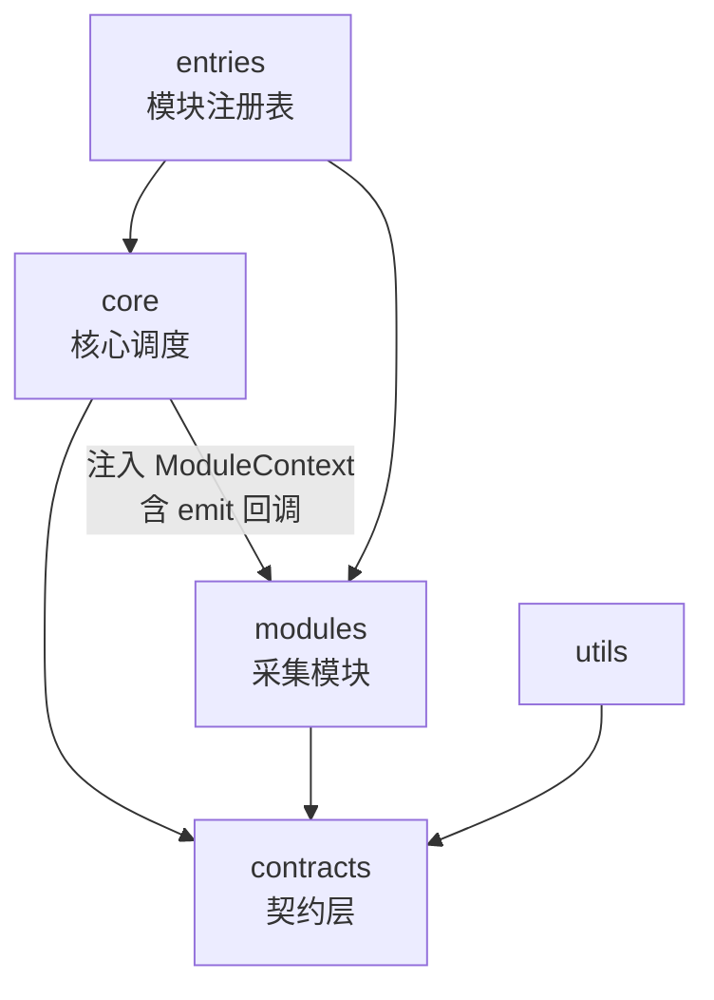

# monitor-report 实现规格书（AI 代码生成专用）

| 项目 | 内容 |
| --- | --- |
| 规格版本 | `spec-1.0.0` |
| 对应 SDK 版本 | `1.0.0` |
| 上报协议版本 | `schemaVersion = 1` |
| 目标 | 本文件是**唯一的实现依据**。按本文件生成的代码即满足验收标准，无需参考其他文档 |
| 生成方式 | 按第 14 章的任务包 T-01 ~ T-15 **逐个**生成，每包生成后立即跑测试，通过后再进下一包 |

---

## 0. 给生成方的指令（先读这一段）

### 0.1 工作方式

1. **不要一次性生成整个项目。** 按第 14 章的任务包顺序，一次只做一包，每包完成后运行 `npm test` 与 `npm run typecheck`，全部通过才进入下一包。
2. **第 13 章的「禁止事项」优先级高于你自己的技术直觉。** 其中每一条都对应一个真实会出事的坑，不理解也必须遵守；若你认为某条不合理，先按它实现，再在注释里标注疑问，不要自行改设计。
3. **不得新增本文件未列出的依赖。** 运行时依赖必须为 0（零 runtime dependency 是硬约束）。开发依赖见 2.2。
4. **不得自行扩展功能范围。** 第 1.2 节「本期不做」的内容一律不实现，包括不做预留接口。
5. 任何本文件未规定的细节，选择**最简单、依赖最少**的方案，并在代码注释里标记 `// SPEC-GAP:` 说明你的选择。

### 0.2 代码风格硬约束

- TypeScript `strict: true`，禁止 `any`（唯一例外：`extra?: Record<string, unknown>`）。
- 禁止在模块顶层执行副作用（不得在模块作用域调用 `window.*`、`document.*`、`new PerformanceObserver` 等）——所有副作用必须发生在函数内部，否则 Tree Shaking 失效。
- 所有对外导出的函数/类型必须有 JSDoc 简述。
- 每个源文件顶部不超过 5 行文件说明注释。
- 单文件不超过 300 行；超出则按职责拆分。

---

## 1. 项目范围

### 1.1 本期生成（IN）

| 编号 | 交付物 | 说明 |
| --- | --- | --- |
| D-01 | 核心层 `LogReport` | 配置合并、数据管道、上报调度、生命周期 |
| D-02 | 契约层 | 类型、接口、常量（无逻辑） |
| D-03 | 错误监控模块 | 三通道采集 + 归一化 + 计数式去重 |
| D-04 | 性能监控模块 | FCP / LCP / FID / INP / CLS，终态上报 |
| D-05 | 网络监控模块 | fetch / XHR 包装采集，可取消分类 |
| D-06 | 内存采样模块 | JS 堆采样 + 增长趋势（独立子路径，不进默认入口） |
| D-07 | Vue 2 / Vue 3 适配插件 | 挂载 `errorHandler` 且**保留并调用**原有 handler |
| D-08 | 数据脱敏器 | URL query 脱敏、CSS 选择器脱敏、文本 PII 兜底脱敏 |
| D-09 | 多入口构建 | `index`（全量）+ `error` / `performance` / `network` / `memory` 子路径 |
| D-10 | 单元测试 | 见第 11 章测试矩阵 |
| D-11 | 工程配置 | package.json / tsconfig / 构建 / CI / size-limit |
| D-12 | README（接入说明） | 含 SSR、CSP、`crossorigin` 部署要求 |

### 1.2 本期不做（OUT，不得预留实现）

| 不做项 | 理由 |
| --- | --- |
| 页面录屏 / 会话回放（rrweb） | 范围外，且涉及隐私合规审查 |
| Source Map 平台内反解 | 后端能力，不在 SDK 范围 |
| 白屏检测 | 需要产品侧定义判定口径，延后 |
| 长任务监控（longtask） | 延后到 1.1；本期不得预留接口 |
| PV / UV / 停留时长 | 后端可从 pageUrl + sessionId 统计 |
| 告警规则、看板、平台前端 | 非 SDK 职责 |
| 全链路 Trace 采样决策 | 本期只做 `traceId` 透传字段 |
| IE / 老旧浏览器支持 | 见 2.3 支持矩阵 |

---

## 2. 技术栈锁定

### 2.1 运行时

| 项 | 取值 | 说明 |
| --- | --- | --- |
| 语言 | TypeScript 5.4+ | `strict: true`，`noUncheckedIndexedAccess: true` |
| 运行时依赖 | **0 个** | 只允许浏览器原生 API |
| 产物格式 | ESM（主）/ CJS / IIFE | IIFE 供 `<script>` 直引，挂 `window.MonitorReport` |
| 目标语法 | ES2018 | 不做 ES5 降级 |
| 上报传输 | `fetch` + `keepalive`，降级 `sendBeacon` | 见 6.5 |

### 2.2 开发依赖（白名单，不得增删）

```
typescript  vitest  happy-dom  tsup  size-limit  @size-limit/preset-small-lib
eslint  @typescript-eslint/parser  @typescript-eslint/eslint-plugin
prettier  husky  lint-staged  @changesets/cli
```

> 不使用 Rollup + Babel 组合。理由：单工具链、少一层转译、与 ES2018 目标一致（不降级 ES5，故不需要 Babel）。

### 2.3 浏览器支持矩阵

| 浏览器 | 最低版本 |
| --- | --- |
| Chrome / Edge | 90 |
| Firefox | 90 |
| Safari（桌面 / iOS） | 14 |
| 其他 | 不做保证 |

不支持的环境必须**静默降级**：`init()` 返回实例但所有能力内部 no-op，且不抛错、不产生上报。

---

## 3. 目录结构（逐文件职责）

```
monitor-report/
├── src/
│   ├── contracts/                      # 契约层：只有类型与接口，零逻辑
│   │   ├── log.ts                      # ReportLog 联合类型 + 各维度 data 类型
│   │   ├── config.ts                   # UserConfig / ResolvedConfig
│   │   ├── emitter.ts                  # ReportEmitter、ModuleContext、MonitorModule
│   │   └── index.ts
│   ├── constants/
│   │   ├── defaults.ts                 # 默认配置（见 5.1）
│   │   ├── thresholds.ts               # Web Vitals 评级阈值（见 5.2）
│   │   └── version.ts                  # sdkVersion / schemaVersion（构建期注入）
│   ├── core/
│   │   ├── LogReport.ts                # 核心主类（唯一状态持有者）
│   │   ├── env.ts                      # isBrowser() / isSupported()
│   │   ├── config.ts                   # 配置合并与校验
│   │   ├── pipeline.ts                 # 过滤 → 公共字段 → 脱敏 → 限额
│   │   ├── queue.ts                    # 缓存队列 + 上限丢弃 + droppedCount
│   │   ├── scheduler.ts                # 防抖 + flush + 失败回塞 + 卸载兜底
│   │   ├── transport.ts                # fetch / keepalive / sendBeacon 降级
│   │   ├── singleton.ts                # 重复注入保护
│   │   └── registry.ts                 # ModuleRegistry 类型与构造函数
│   ├── modules/
│   │   ├── error/
│   │   │   ├── index.ts                # createErrorMonitor()
│   │   │   ├── channels.ts             # 三通道监听与解绑
│   │   │   ├── normalize.ts            # 错误归一化与指纹
│   │   │   └── selector.ts             # 元素选择器生成（脱敏）
│   │   ├── performance/
│   │   │   ├── index.ts                # createPerformanceMonitor()
│   │   │   ├── observers.ts            # 各指标 Observer 配置表
│   │   │   ├── lcp.ts                  # LCP 终值状态机
│   │   │   ├── cls.ts                  # CLS 会话窗口
│   │   │   └── inp.ts                  # INP 分位计算
│   │   ├── network/
│   │   │   ├── index.ts                # createNetworkMonitor()
│   │   │   ├── fetch.ts                # fetch 包装
│   │   │   └── xhr.ts                  # XHR 包装
│   │   └── memory/
│   │       └── index.ts                # createMemoryMonitor()
│   ├── plugins/
│   │   ├── vue2.ts
│   │   └── vue3.ts
│   ├── utils/
│   │   ├── mask.ts                     # 脱敏器（D-08）
│   │   ├── hash.ts                     # 稳定指纹
│   │   ├── debounce.ts
│   │   ├── time.ts                     # 时间戳 / timeOrigin 校正
│   │   └── once.ts
│   ├── entries/
│   │   ├── full.ts                     # 全部模块注册表
│   │   ├── error.ts                    # 仅 error + core
│   │   ├── performance.ts
│   │   ├── network.ts
│   │   └── memory.ts
│   ├── index.ts                        # 全量入口：createMonitor()
│   ├── error.ts                        # 子路径入口
│   ├── performance.ts
│   ├── network.ts
│   └── memory.ts
├── tests/
│   ├── setup.ts                        # 全局 mock（PerformanceObserver / fetch / XHR）
│   ├── unit/…                          # 与被测模块一一对应
│   └── acceptance/…                    # 第 12 章验收用例
├── package.json
├── tsconfig.json
├── tsup.config.ts
├── vitest.config.ts
├── .size-limit.json
├── .eslintrc.cjs
└── README.md
```

**模块依赖方向（硬约束）**



规则：`modules/*` **不得** import `core/*`；`core/*` **不得** import `modules/*`（只认 `ModuleRegistry` 接口）。`contracts/*` 不 import 任何内部模块。

---

## 4. 契约层完整定义

`src/contracts/log.ts`

```ts
export type LogType = 'error' | 'performance' | 'network' | 'memory' | 'custom'

export interface LogBase {
  appId: string
  type: LogType
  schemaVersion: number
  sdkVersion: string
  env: 'production' | 'development' | 'test'
  timestamp: number
  timeOriginCorrected: number
  pageUrl: string
  pagePath: string
  navigationType: 'navigate' | 'reload' | 'back_forward' | 'prerender' | 'unknown'
  ua: string
  sessionId: string
  userId?: string
  release?: string
  traceId?: string
  tags?: Record<string, string>
  extra?: Record<string, unknown>
}

export interface ErrorData {
  errorType: 'js_error' | 'promise_error' | 'resource_error' | 'vue_error'
  message: string
  stack?: string
  fileName?: string
  lineNo?: number
  colNo?: number
  resourceUrl?: string
  resourceType?: string
  selector?: string
  crossOrigin?: boolean
  count: number
  firstSeen: number
  lastSeen: number
}

export interface PerformanceData {
  metricName: 'FCP' | 'LCP' | 'FID' | 'INP' | 'CLS'
  value: number
  rating: 'good' | 'needs-improvement' | 'poor'
  entryType: string
  startTime: number
  interactionCount?: number
  layoutShiftSources?: string[]
}

export interface NetworkData {
  reqUrl: string
  reqMethod: string
  reqStartTime: number
  reqDuration: number
  resOk: boolean
  resStatus?: number
  resStatusText?: string
  aborted: boolean
  errorMessage?: string
  reqBodySize?: number
  resBodySize?: number
}

export interface MemoryData {
  usedJSHeapSize: number
  totalJSHeapSize: number
  jsHeapSizeLimit: number
  usageRate: number
  sampleIndex: number
  deltaBytes: number | null
  growthPerMinute: number | null
}

export interface ErrorLog extends LogBase { type: 'error'; data: ErrorData }
export interface PerformanceLog extends LogBase { type: 'performance'; data: PerformanceData }
export interface NetworkLog extends LogBase { type: 'network'; data: NetworkData }
export interface MemoryLog extends LogBase { type: 'memory'; data: MemoryData }
export interface CustomLog extends LogBase { type: 'custom'; data: Record<string, unknown> }

export type ReportLog = ErrorLog | PerformanceLog | NetworkLog | MemoryLog | CustomLog
export type LogDataOf<T extends LogType> =
  T extends 'error' ? ErrorData :
  T extends 'performance' ? PerformanceData :
  T extends 'network' ? NetworkData :
  T extends 'memory' ? MemoryData : Record<string, unknown>
```

`src/contracts/emitter.ts`

```ts
import type { LogType, LogDataOf, ReportLog } from './log'
import type { ResolvedConfig } from './config'

export interface ReportEmitter {
  emit<T extends LogType>(type: T, data: LogDataOf<T>): void
}

export interface ModuleContext {
  config: ResolvedConfig
  emitter: ReportEmitter
  onTeardown(fn: () => void): void
  isPageHidden(): boolean
  now(): number
}

export interface MonitorModule {
  readonly name: LogType
  start(ctx: ModuleContext): void
  stop(): void
}

export type ModuleFactory = () => MonitorModule
export type ModuleRegistry = Partial<Record<LogType, ModuleFactory>>
```

`src/contracts/config.ts`

```ts
export interface UserConfig {
  appId: string
  reportUrl?: string
  env?: 'production' | 'development' | 'test'
  modules?: Array<'error' | 'performance' | 'network' | 'memory'>
  release?: string
  sample?: Partial<Record<'error' | 'performance' | 'network' | 'memory', number>>
  debounceTime?: number
  maxLogsPerPage?: number
  lazyReport?: boolean
  urlBlacklist?: string[]
  ignoreErrors?: Array<string | RegExp>
  dedupWindow?: number
  maskQueryKeys?: string[]
  reportPerformanceOnHiddenOnly?: boolean
  extra?: Record<string, unknown>
  tags?: Record<string, string>
  beforeSend?: (log: ReportLog) => ReportLog | null
  request?: (logs: ReportLog[]) => void | Promise<void>
  unloadRequest?: (logs: ReportLog[]) => void
  requestConfig?: { headers?: Record<string, string>; timeout?: number }
  performance?: { clsReportThreshold?: number }
  network?: { collectResourceTiming?: boolean }
  memory?: { interval?: number; reportOnlyOnGrowth?: boolean; growthThresholdPerMinute?: number }
  debug?: boolean
}
```

> `beforeSend` 允许**修改或丢弃**（返回 `null` 丢弃），不得只支持布尔返回。

---

## 5. 常量与默认值

### 5.1 默认配置（`src/constants/defaults.ts`）

| 配置项 | 默认值 | 说明 |
| --- | --- | --- |
| `env` | `'production'` | |
| `modules` | `['error', 'performance']` | 网络与内存默认关闭（噪音与兼容性考虑） |
| `sample` | 全部 `1` | 采样率；调低上报量的唯一推荐手段 |
| `debounceTime` | `1000` | 批报防抖间隔（ms） |
| `maxLogsPerPage` | `300` | 单页缓存上限，超出丢最旧并累加 `droppedCount` |
| `lazyReport` | `false` | 开启后进 `reportQueue` 缓存，等 `startReport()` |
| `urlBlacklist` | `[]` | 子串匹配；自动追加本次 `reportUrl` |
| `ignoreErrors` | `[]` | 匹配 `message`，命中则丢弃 |
| `dedupWindow` | `5000` | 错误指纹去重窗口（ms） |
| `maskQueryKeys` | `[]` | query 参数**值保留**的白名单；不在白名单的值一律置 `[filtered]` |
| `reportPerformanceOnHiddenOnly` | `true` | 性能指标只在隐藏/卸载时上报终值 |
| `requestConfig.timeout` | `10000` | ms |
| `memory.interval` | `30000` | 采样间隔（ms） |
| `memory.reportOnlyOnGrowth` | `true` | 仅当增长超阈值才上报 |
| `memory.growthThresholdPerMinute` | `3145728` | 3MB/min |

### 5.2 指标评级阈值（`src/constants/thresholds.ts`）

| 指标 | good | needs-improvement | poor |
| --- | --- | --- | --- |
| FCP | ≤ 1800ms | ≤ 3000ms | > 3000ms |
| LCP | ≤ 2500ms | ≤ 4000ms | > 4000ms |
| FID | ≤ 100ms | ≤ 300ms | > 300ms |
| INP | ≤ 200ms | ≤ 500ms | > 500ms |
| CLS | ≤ 0.1 | ≤ 0.25 | > 0.25 |

> **阈值只用于生成 `rating` 字段，绝不允许用于丢弃数据。**

### 5.3 其他常量

| 常量 | 值 | 用途 |
| --- | --- | --- |
| `DEDUP_MAP_MAX` | `200` | 去重表条目上限，LRU 淘汰 |
| `STACK_MAX_FRAMES` | `10` | 堆栈截断帧数 |
| `BEACON_MAX_BYTES` | `60000` | keepalive / sendBeacon 体积上限（官方 64KB，留余量） |
| `XHR_BODY_PREVIEW_MAX` | `0` | 本期不采集请求体内容（隐私） |
| `PERF_REPORT_FALLBACK_MS` | `60000` | 长驻页面性能终值兜底上报间隔 |

---

## 6. 核心层实现规格

### 6.1 环境守卫（`core/env.ts`）

```ts
export function isBrowser(): boolean
export function isSupported(): boolean
```

- `isBrowser()`：`typeof window !== 'undefined' && typeof document !== 'undefined'`。
- `isSupported()`：在 `isBrowser()` 基础上校验 `Object.defineProperty`、`WeakMap`、`addEventListener` 存在。
- **`LogReport` 构造函数第一件事就是调用 `isBrowser()`**；不成立时设置 `this.disabled = true`，所有公开方法立即返回，不注册任何监听、不访问任何浏览器 API、不抛错。

### 6.2 配置合并（`core/config.ts`）

- 深合并 `defaults` 与 `UserConfig`，`modules` 数组以用户值为准（不合并）。
- 校验：`appId` 必填，缺失则 `throw new Error('[monitor-report] appId is required')`。
- `reportUrl` 缺失且未提供 `request` 时，`throw new Error('[monitor-report] reportUrl or request is required')`。
- 自动把 `reportUrl` 加入 `urlBlacklist`（避免监控自身请求被采集形成递归）。
- 解析后的配置为 `ResolvedConfig`（所有字段必填，只读）。

### 6.3 数据管道（`core/pipeline.ts`）

处理顺序**固定**，不得调整：


1. **采样**：`Math.random() < sample[type]` 通过则继续；否则静默丢弃（计入 `sampledOut`，不单独上报）。
2. **类型开关**：`type` 不在 `modules` 中 → 丢弃。
3. **规则过滤**：`ignoreErrors` 命中 `data.message` → 丢弃；`urlBlacklist` 命中 `data.reqUrl` → 丢弃。
4. **补全公共字段**：`appId / schemaVersion / sdkVersion / env / timestamp / pageUrl / pagePath / navigationType / ua / sessionId / userId / release / traceId / tags / extra`。`pageUrl` **在此刻快照**（此后不再读取 `location`）。
5. **脱敏**：调用 `maskLog()`（见第 9 章），不可跳过。
6. **`beforeSend`**：返回 `null` 则丢弃，否则使用返回值。
7. **入队**：写入 `queue`。

### 6.4 队列与调度

**`core/queue.ts`**

- 内部为数组，容量 `maxLogsPerPage`。
- 超限：丢弃**最旧**一条，`droppedCount++`。
- `add(log)` / `drainAll(): ReportLog[]` / `size` / `droppedCount`。
- `drainAll()` 时若 `droppedCount > 0`，在本次批次末尾追加一条 `custom` 类型的 `{event: 'logs_dropped', count: droppedCount}` 并清零。

**`core/scheduler.ts`**

- `addReport` 后启动 `debounce(debounceTime)`；到期执行 `flush()`。
- `flush()`：`drainAll()` → 空则返回 → 调 `transport.send(logs)` → 成功则结束；失败则 `queue.prepend(logs)`（回塞队首，保持顺序）并**指数退避**重试（1s / 2s / 4s，最多 3 次，之后放弃并计入 `failedCount`）。
- **卸载链路**（关键）：
  - 监听 `document.addEventListener('visibilitychange')`：`visibilityState === 'hidden'` 时 → ① 触发性能模块结算终值；② `flush({ unload: true })`。
  - 监听 `window.addEventListener('pagehide', h)`：同上（第二重保险）。
  - **禁止使用 `unload` 与 `beforeunload`。**
  - `unload: true` 的 flush 使用 6.5 的卸载传输策略；若使用自定义 `request`，则改调 `unloadRequest`（未提供则跳过并计入 `droppedCount`）。
- 对外：`flushReport()`（手动立即上报）、`startReport()`（退出延迟模式并把 `reportQueue` 重走完整管道）。

### 6.5 传输层（`core/transport.ts`）

```
常规上报（未卸载）：
  fetch(reportUrl, { method:'POST', headers:{'Content-Type':'application/json', ...requestConfig.headers},
                     body: JSON.stringify(payload), signal: AbortSignal.timeout(timeout) })

卸载上报（unload: true）：
  ① 若 body 字节数 ≤ BEACON_MAX_BYTES 且支持 fetch keepalive：
       fetch(reportUrl, { ..., keepalive: true })
       —— keepalive 允许自定义 header，优先使用
  ② 否则降级：
       navigator.sendBeacon(reportUrl, new Blob([body], { type: 'application/json' }))
       —— sendBeacon 无法携带自定义 header，因此鉴权信息必须同时在 body 内
  ③ 二者均不可用时：跳过，计入 droppedCount（不得使用同步 XHR）
```

**硬约束**

- 上报体的**顶层结构固定**为：
  ```json
  { "appId": "…", "sdkVersion": "…", "schemaVersion": 1, "sentAt": 1727000000000,
    "pageUrl": "…", "samples": [ /* ReportLog[] */ ] }
  ```
  鉴权 token 若需随体传递，放在顶层 `token` 字段（由 `extra` 或 `requestConfig` 指定，不得写死在 header 里唯一的通路）。
- `requestConfig.headers` 只作用于 ① 常规上报与 ②-A keepalive 路径；文档中必须写明 sendBeacon 降级路径不带 header。
- HTTP 2xx 视为成功，其余（含网络异常）视为失败。
- 自定义 `request`：**完全替换**传输逻辑，不走队列重试；文档必须写明该模式失去卸载兜底，需自行实现 `unloadRequest`。

### 6.6 生命周期（`core/LogReport.ts`）

公开 API：

| 方法 | 签名 | 行为 |
| --- | --- | --- |
| `addReport` | `<T extends LogType>(type: T, data: LogDataOf<T>) => void` | 手动上报，走完整管道 |
| `setExtra` | `(extra: Record<string, unknown>) => void` | 合并 extra |
| `setUser` | `(userId: string) => void` | 设置 userId |
| `setTag` | `(k: string, v: string) => void` | 设置 tag |
| `setTraceId` | `(traceId: string) => void` | 设置链路 ID |
| `startReport` | `() => void` | 退出延迟模式 |
| `flushReport` | `() => void` | 立即上报 |
| `destroy` | `(opts?: { flush?: boolean }) => void` | `flush` 默认 `true`：先 flush 再去注册 |
| `getStatus` | `() => { queued: number; dropped: number; failed: number; disabled: boolean }` | 自诊断 |

`destroy()` 清理清单（一项都不能少）：所有 `addEventListener` 的解绑函数、所有 `PerformanceObserver.disconnect()`、`setInterval` / `setTimeout`、`AbortController.abort()`、清空 `queue` / `dedupMap` / `reportQueue`、调用所有 `onTeardown` 回调、从单例注册表移除自己。

### 6.7 重复注入保护（`core/singleton.ts`）

- 全局 key：`window.__MONITOR_REPORT__`，存 `{ version: string, instance: LogReport }`。
- 已存在实例时：若 `version` 相同 → 打印 warning 并**复用**已有实例，`init()` 返回它；若版本不同 → 打印 warning，把旧实例 `destroy()` 后新建。
- 生产环境下 warning 也保留（便于排查重复注入），但不得 `throw`。

---

## 7. 采集模块实现规格

### 7.1 错误监控（`modules/error/`）

**三通道，各自独立注册与解绑**

| 通道 | 注册方式 | 采集范围 | 关键约束 |
| --- | --- | --- | --- |
| 同步 JS 错误 | `window.addEventListener('error', h)` | 运行时错误、语法错误 | **禁止 `window.onerror = h`**；`e.error` 可能为 `null`，需空值保护 |
| 资源加载失败 | `window.addEventListener('error', h2, true)` | img / script / link / css / audio / video | **必须传第三参 `true`**（资源错误不冒泡）；用 `e.target` 区分资源与 JS：`e.target instanceof HTMLElement && e.target !== window` 判为资源错误 |
| Promise 未处理拒绝 | `window.addEventListener('unhandledrejection', h3)` 与 `rejectionhandled` | reject 无 catch | `rejectionhandled` 用于给"事后补 catch"的事件打标，**不得当作新错误上报** |

**归一化与指纹（`normalize.ts`）**

```
normalizeMessage(msg):
  1. 去首尾空白，截断到 300 字符
  2. 替换 UUID           /[0-9a-f]{8}-[0-9a-f]{4}-[0-9a-f]{4}-[0-9a-f]{4}-[0-9a-f]{12}/gi → '<uuid>'
  3. 替换长 hex          /[0-9a-f]{16,}/gi → '<hex>'
  4. 替换 URL            /https?:\/\/[^\s)'"]+/gi → '<url>'
  5. 替换数字串          /\d+/g → '<n>'
  6. 替换引号内容        /'[^']*'|"[^"]*"/g → '<str>'

fingerprint(error):
  key = [
    errorType,
    normalizeMessage(message),
    basenameWithoutHash(fileName),   // 去掉 query/hash，并用 /[.-][0-9a-f]{6,}\./i 剥离构建 hash
    topFrameFnName(stack),           // 只取函数名，不含行列号
    crossOrigin ? 'x' : ''           // 跨域错误必须参与指纹，避免全部塌缩成一条
  ].join('|')
  return fnv1a(key)   // 32 位数字字符串，禁止用 crypto API（性能与兼容）
```

**去重 = 计数聚合（不是丢弃）**

- `dedupMap: Map<fingerprint, { count, firstSeen, lastSeen, log }>`，容量 `DEDUP_MAP_MAX`，LRU 淘汰。
- 命中已有指纹 → 仅递增 `count` / 更新 `lastSeen`，**不 emit**。
- 窗口到期（距 `lastSeen` 超过 `dedupWindow`）或 `destroy()` / 页面隐藏 → 把聚合后的 `log`（`data.count / firstSeen / lastSeen` 已填充）emit 出去。
- 定时器用**单个** `setInterval(dedupWindow)` 扫描，禁止每条错误一个定时器。

**跨域脚本错误**

- 若 `message === 'Script error.'` 或 `message` 为空且无 `stack` → 置 `crossOrigin: true`，并把 `fileName` 记为 `'unknown-cross-origin'`。
- **必须在 README 中写明部署要求**：业务方需要给 `<script>` 加 `crossorigin` 属性，且 CDN 返回 `Access-Control-Allow-Origin`。

**选择器脱敏（`selector.ts`）**

- 只输出 `父标签 > 标签:nth-child(n)` 形式，**最多 4 层**。
- **禁止输出 `id`、`class`、`data-*` 的属性值**。

### 7.2 性能监控（`modules/performance/`）

**指标 ↔ entry type 对照表（`observers.ts`）**

| 指标 | entryType | Observer 配置 | 上报时机 |
| --- | --- | --- | --- |
| FCP | `paint` | `{ type:'paint', buffered:true }`，取 `name === 'first-contentful-paint'` | 采集到即可，但统一在 flush 时发 |
| LCP | `largest-contentful-paint` | `{ type:'largest-contentful-paint', buffered:true }`，**持续监听** | **页面隐藏 / pagehide / 兜底定时器** |
| FID | `first-input` | `{ type:'first-input', buffered:true }`，取 `processingStart - startTime` | 采集到即可 |
| INP | `event` | `{ type:'event', buffered:true, durationThreshold:40 }` | 页面隐藏时结算 |
| CLS | `layout-shift` | `{ type:'layout-shift', buffered:true }` | 页面隐藏时结算 |

**所有 Observer 必须带 `buffered: true`**——否则 SDK 晚加载时指标永久丢失。

**LCP 状态机（`lcp.ts`）——最容易写错的点**

```
onEntry(entry):  if (entry.startTime > state.value) { state.value = entry.startTime; state.entry = entry }
禁止在拿到首个 entry 后 disconnect()
禁止在首次 LCP 后上报
finalize(): 在 visibilitychange(hidden) / pagehide 时读取 state.value 上报终值
兜底：PERF_REPORT_FALLBACK_MS 定时器，未见隐藏时也上报一次
```

**CLS 会话窗口（`cls.ts`）**

```
维护 window: { value, startTime, lastEntryTime } 与 maxWindowValue
对每个 entry：
  if (entry.hadRecentInput) continue                      // 必须跳过
  if (!window) 新建
  else if (entry.startTime - window.lastEntryTime > 1000
        || entry.startTime - window.startTime > 5000) 结算并新建
  window.value += entry.value
  window.lastEntryTime = entry.startTime
  maxWindowValue = max(maxWindowValue, window.value)
终值上报 maxWindowValue（CLS 无单位，value 保留 4 位小数）
layoutShiftSources 取每条的 source.node 选择器（走 selector 脱敏），最多 5 条
```

`performance.clsReportThreshold` 默认 `0`（即全量上报）。**禁止把 0.1 用作过滤条件。**

**INP 分位（`inp.ts`）**

```
仅收集 entry.interactionId > 0 的条目（interactionId === 0 必须跳过，否则污染）
同一 interactionId 只保留最大 duration
结算：升序排序 → index = max(0, ceil(n * 0.02) - 1) → 取该值
n === 0 时不上报
同时上报 interactionCount = n
```

**导航类型与 bfcache**

- `navigationType` 从 `performance.getEntriesByType('navigation')[0]?.type` 读取，缺省 `'unknown'`。
- `navigationType === 'back_forward'` 时，**FCP / LCP 标记为不上报**（bfcache 恢复下该值无意义），INP / CLS 正常上报。

**上报策略**

- `reportPerformanceOnHiddenOnly: true`（默认）时，除 FID 外全部在隐藏时结算上报。
- 隐藏已经发生的场景（SDK 初始化晚于用户切走）：初始化时若 `document.visibilityState === 'hidden'`，立即用 `buffered` 数据结算并上报一次。

### 7.3 网络监控（`modules/network/`）

**采集范围**：仅 `fetch` 与 `XMLHttpRequest` 发起的请求。静态资源由错误监控的 capture 通道负责，**网络模块不碰静态资源，禁止用 URL 前缀规则区分**。

**fetch 包装（`fetch.ts`）**

```ts
const original = window.fetch
window.fetch = function (input, init) { … }   // 必须保留 this 与全部参数原样透传
```

约束清单：
1. `url` 提取顺序：`typeof input === 'string'` → input；`input instanceof URL` → `input.href`；`input instanceof Request` → `input.url`。
2. **原样调用** `original.apply(this, arguments)`，不得重建 `Request`（重建会改变 body / mode / credentials 行为）。
3. 返回值必须是原始 `Response` 本身，**不得替换或包装**；需要读 body 时必须 `clone()`，本期默认不读 body。
4. 成功：读 `res.status` / `res.ok`，`reqDuration = performance.now() - start`。
5. 失败：`err.name === 'AbortError'` → `aborted: true`，`resOk: true`，**不计为失败**、不进错误聚合；其他异常 → `resOk: false` + `errorMessage`。
6. 劫持前检查 `window.fetch.__monitorWrapped`，已包裹则跳过（防多 SDK 递归）。
7. 解绑：`stop()` 时恢复 `original`（仅当当前仍是本次包裹的函数）。

**XHR 包装（`xhr.ts`）**

- 用 `WeakMap<XMLHttpRequest, Meta>` 存元数据，**禁止给实例挂可枚举属性**。
- 包装 `open`（记录 method / url）与 `send`（记录 start），监听 `loadend`（成功/失败统一出口）、`error`、`timeout`、`abort`。
- `abort` → `aborted: true`，不计失败。
- 包装必须幂等（`__monitorWrapped` 标记）。

**公共规则**

- 出口统一走 `urlBlacklist` 判定（含自动追加的 `reportUrl`）。
- `collectResourceTiming` 默认 `false`：本期**不**从 `PerformanceObserver` 的 `resource` 条目补 DNS / connect / TTFB 字段。
  - 理由（写入注释）：`PerformanceResourceTiming` 条目与 XHR 实例之间没有关联 ID，同 URL 并发时 method / status 会与条目错配；且跨域资源缺 `Timing-Allow-Origin` 时相关字段恒为 0。若要启用，需实现「URL + startTime ±50ms 的 FIFO 匹配」，属 T-15 可选任务。

### 7.4 内存采样（`modules/memory/`）

- 兼容检测：`(performance as any).memory` 不存在 → 模块静默禁用（`start()` 直接返回，不上报也不报错）。
- 采样：`setInterval(interval)`，回调内若 `document.visibilityState === 'hidden'` 则**直接 return**（后台标签页定时器被节流，避免产生失真间隔）。
- 保留最近 5 个样本，计算 `deltaBytes`（与上一采样差）与 `growthPerMinute`（线性斜率换算 / 分钟）。
- `reportOnlyOnGrowth: true` 时，仅当 `growthPerMinute >= growthThresholdPerMinute` 才 `emit`；否则不上报（避免每 30s 一条噪音）。
- 该模块**只进 `monitor-report/memory` 子路径**，不进全量入口的默认 `modules`。
- 边界必须在 JSDoc 中写明：仅 Chromium；数值经量化（约 100KB 粒度）；只覆盖 JS 堆，不含 DOM / CSS / GPU / Worker。

### 7.5 Vue 适配插件（`plugins/`）

**Vue 3（`vue3.ts`）**

```ts
export const vueErrorPlugin = {
  install(app, options: { monitor: LogReport }) {
    const prev = app.config.errorHandler
    app.config.errorHandler = (err, instance, info) => {
      options.monitor.addReport('error', toErrorData(err, 'vue_error', info))
      if (typeof prev === 'function') prev(err, instance, info)   // 必须保留调用
    }
  }
}
```

**Vue 2（`vue2.ts`）**：同逻辑，挂在 `Vue.config.errorHandler`（`(err, vm, info)`），同样保留并调用 `prev`。

硬约束：**必须保留并调用用户原有的 `errorHandler`**，否则会吞掉业务方自己的错误处理。

---

## 8. 公共字段与上报协议

### 8.1 公共字段（每条 log 必带）

| 字段 | 类型 | 来源 |
| --- | --- | --- |
| `appId` | string | 配置 |
| `type` | LogType | 采集方 |
| `schemaVersion` | number | 常量 `1` |
| `sdkVersion` | string | 构建期注入 |
| `env` | string | 配置 |
| `timestamp` | number | `Date.now()` |
| `timeOriginCorrected` | number | `Date.now() - Math.round(performance.timeOrigin + entry.startTime)`，用于校正客户端时钟偏差 |
| `pageUrl` | string | 采集时刻快照（已脱敏） |
| `pagePath` | string | `pathname + hash`（不含 query） |
| `navigationType` | string | Navigation Timing |
| `ua` | string | `navigator.userAgent` |
| `sessionId` | string | 每次页面加载随机生成（`Math.random().toString(36)` × 2 拼接） |
| `userId?` / `release?` / `traceId?` / `tags?` / `extra?` | — | 由宿主设置 |

### 8.2 上报体

```json
{
  "appId": "project-web-001",
  "sdkVersion": "1.0.0",
  "schemaVersion": 1,
  "sentAt": 1727000000000,
  "pageUrl": "https://example.com/path?a=[filtered]",
  "samples": [ { "type": "error", "data": { } } ]
}
```

HTTP 2xx = 成功。响应体不做解析。

---

## 9. 数据安全与脱敏（不可跳过）

`src/utils/mask.ts` 导出 `maskLog(log: ReportLog): ReportLog`，在管道第 5 步强制执行。

| 字段 | 规则 |
| --- | --- |
| `pageUrl` / `pagePath` | **移除 query 中的 value**：`?a=1&b=2` → `?a=[filtered]&b=[filtered]`；`maskQueryKeys` 中的 key 保留原值；`#` 后的 hash 一并脱敏 |
| `data.resourceUrl` / `data.reqUrl` | 同上（query 脱敏，保留 path） |
| `data.selector` | 只保留标签与 `:nth-child`，最多 4 层 |
| `data.stack` | 截断到 `STACK_MAX_FRAMES` 帧 |
| 所有 string 字段 | 兜底正则：邮箱 → `<email>`；中国大陆手机号（`1[3-9]\d{9}`）→ `<phone>`；18 位身份证 → `<id>` |
| `extra` / `tags` | 不递归清洗（宿主责任），但**必须在上报体中发现上述 PII 时于 `debug: true` 下打印 warning** |

README 必须包含一节「接入方责任」，明确：`extra` / `tags` / `custom` 数据不得承载个人身份信息。

---

## 10. 工程配置

### 10.1 `package.json` 关键字段

```json
{
  "name": "monitor-report",
  "version": "1.0.0",
  "type": "module",
  "sideEffects": false,
  "files": ["dist", "README.md"],
  "main": "./dist/index.cjs",
  "module": "./dist/index.js",
  "types": "./dist/index.d.ts",
  "exports": {
    ".": { "types": "./dist/index.d.ts", "import": "./dist/index.js", "require": "./dist/index.cjs" },
    "./error": { "types": "./dist/error.d.ts", "import": "./dist/error.js", "require": "./dist/error.cjs" },
    "./performance": { "types": "./dist/performance.d.ts", "import": "./dist/performance.js", "require": "./dist/performance.cjs" },
    "./network": { "types": "./dist/network.d.ts", "import": "./dist/network.js", "require": "./dist/network.cjs" },
    "./memory": { "types": "./dist/memory.d.ts", "import": "./dist/memory.js", "require": "./dist/memory.cjs" },
    "./package.json": "./package.json"
  },
  "scripts": {
    "build": "tsup",
    "typecheck": "tsc --noEmit",
    "lint": "eslint src tests --ext .ts",
    "test": "vitest run",
    "test:watch": "vitest",
    "size": "size-limit",
    "ci": "npm run lint && npm run typecheck && npm run test && npm run build && npm run size"
  }
}
```

必须包含 `"sideEffects": false`——它是"按需引入"能否生效的前提之一。

### 10.2 `tsup.config.ts`

```ts
export default defineConfig({
  entry: {
    index: 'src/index.ts',
    error: 'src/error.ts',
    performance: 'src/performance.ts',
    network: 'src/network.ts',
    memory: 'src/memory.ts'
  },
  format: ['esm', 'cjs', 'iife'],
  globalName: 'MonitorReport',
  dts: true,
  sourcemap: true,        // 生产也必须产出，禁止关闭
  minify: true,
  target: 'es2018',
  platform: 'browser',
  clean: true,
  define: { __SDK_VERSION__: JSON.stringify(pkg.version) }
})
```

### 10.3 `.size-limit.json`

```json
[
  { "name": "core + error", "path": "dist/error.js", "limit": "8 kB" },
  { "name": "core + performance", "path": "dist/performance.js", "limit": "8 kB" },
  { "name": "full", "path": "dist/index.js", "limit": "18 kB" }
]
```

### 10.4 CI（`.github/workflows/ci.yml`）

触发：PR 与 main 推送。步骤：`npm ci` → `lint` → `typecheck` → `test` → `build` → `size`。任一步失败即阻断合并。

### 10.5 子路径入口实现范式

```ts
// src/error.ts
import { LogReport } from './core/LogReport'
import { createErrorMonitor } from './modules/error'
import type { UserConfig } from './contracts/config'
import type { ModuleRegistry } from './contracts/emitter'

const registry: ModuleRegistry = { error: createErrorMonitor }

export function createMonitor(config: UserConfig) {
  return new LogReport({ ...config, modules: ['error'] }, registry)
}
export { LogReport }
export * from './contracts/log'
```

验收：单独构建 `dist/error.js` 时，产物中**不得出现** `MemoryMonitor` / `NetworkMonitor` 相关符号。

---

## 11. 测试规格

环境：`vitest` + `happy-dom`。`tests/setup.ts` 必须提供：可手动触发 entry 的 `PerformanceObserver` mock、可拦截的 `fetch` mock、`XMLHttpRequest` mock、`document.visibilityState` 可控切换。

| 测试文件 | 必须覆盖的断言 |
| --- | --- |
| `error.channels.test.ts` | 三条通道各自触发并产出正确 `errorType`；`window.onerror` 保持为 `null`（未被赋值）；资源错误在 capture 阶段被捕获 |
| `error.normalize.test.ts` | 含 UUID / 数字 / URL 的消息归一化后指纹一致；不同 `fileName` 指纹不同；`'Script error.'` 指纹含跨域标记 |
| `error.dedup.test.ts` | 5s 内同指纹只 emit 一次且 `count === n`；窗口到期后 emit 且 `firstSeen < lastSeen` |
| `perf.lcp.test.ts` | 连续 3 个 LCP entry（递增）后 finalize 取**最大值**；未在首个 entry 后 disconnect（断言 `disconnect` 调用次数 ≤ 1 且在 finalize 之后） |
| `perf.cls.test.ts` | `hadRecentInput: true` 被跳过；间隔 >1s 开启新窗口；取最大窗口值而非总和；CLS = 0.05 时**仍然上报** |
| `perf.inp.test.ts` | `interactionId === 0` 被跳过；同 id 取最大 duration；98 分位索引正确；n = 0 不上报 |
| `perf.buffered.test.ts` | 所有 Observer 构造参数均含 `buffered: true` |
| `perf.navigation.test.ts` | `back_forward` 时 FCP / LCP 不上报，INP / CLS 正常 |
| `net.fetch.test.ts` | 返回值 `===` 原 Response（identity）；`Request` 对象入参 URL 正确；`AbortError` 记为 `aborted` 且不计失败；二次包裹不生效 |
| `net.xhr.test.ts` | 实例上无自定义可枚举属性；`abort` 正确分类 |
| `core.pipeline.test.ts` | 管道 7 步顺序正确；采样率 0 时全丢；`urlBlacklist` 含 `reportUrl` |
| `core.scheduler.test.ts` | 防抖批报合并为一次请求；失败回塞保持顺序；**未注册 `unload` / `beforeunload`** |
| `core.transport.test.ts` | 卸载时 body > 60KB 走 sendBeacon；≤ 60KB 走 `fetch({keepalive:true})`；sendBeacon 路径不可带 header |
| `core.lifecycle.test.ts` | `destroy()` 后所有监听被 remove（计数断言）、Observer 全部 disconnect、定时器清空；`isBrowser()` 为 false 时不抛错且不上报 |
| `mask.test.ts` | query value 被替换为 `[filtered]`；白名单 key 保留；邮箱/手机号/身份证被替换；selector 不含 id/class |
| `singleton.test.ts` | 二次 init 复用实例并 warning；版本不同时旧实例被 destroy |
| `entries.treeshake.test.ts` | 构建产物字符串搜索：`dist/error.js` 不含 `MemoryMonitor` |
| `vue.plugin.test.ts` | 原有 `errorHandler` 被调用（spy 断言） |

**覆盖率门槛**：`statements ≥ 80%`，`branches ≥ 70%`。

---

## 12. 验收标准（逐条可自动验证）

| 编号 | 验收项 | 验证方式 |
| --- | --- | --- |
| AC-01 | 非浏览器环境初始化不抛错、不上报 | 单测（`isBrowser` mock 为 false） |
| AC-02 | 未使用 `unload` / `beforeunload` | 源码与产物字符串检索 |
| AC-03 | 未赋值 `window.onerror` | 单测断言 |
| AC-04 | 所有 Observer 带 `buffered: true` | 单测断言构造参数 |
| AC-05 | LCP 取终值而非首值 | 单测 |
| AC-06 | CLS = 0.05 仍上报 | 单测 |
| AC-07 | `modules/*` 不 import `core/*` | `dependency-cruiser` 或简单 grep 断言 |
| AC-08 | 子路径产物不含其他模块符号 | 构建后字符串检索 |
| AC-09 | 产物体积达标 | `size-limit` |
| AC-10 | 生产产物带 sourcemap | 构建后文件存在性断言 |
| AC-11 | 上报体中不含原始 query 值 | 单测（发送前捕获 body） |
| AC-12 | fetch 包装不破坏调用方 | identity 断言 + 真实请求透传测试 |
| AC-13 | `destroy()` 无残留 | 监听/Observer/定时器三项计数断言 |
| AC-14 | Vue 插件保留原 handler | spy 断言 |
| AC-15 | `npm run ci` 全绿 | CI |

---

## 13. 禁止事项（18 条，优先级高于你的技术直觉）

| # | 禁止 | 原因 |
| --- | --- | --- |
| 1 | `window.onerror = fn` | 覆盖宿主与其他 SDK 的处理函数 |
| 2 | LCP 首个 entry 后 `disconnect()` | LCP 是持续更新的候选值，会导致数值系统性偏低 |
| 3 | 任意 Observer 漏 `buffered: true` | SDK 晚加载时指标永久丢失且不报错 |
| 4 | 用指标阈值过滤采集（如 CLS < 0.1 不上报） | 阈值只用于 `rating`，过滤会毁掉分母与趋势 |
| 5 | 使用 `unload` / `beforeunload` | 移动端 Safari 与 bfcache 下不可靠，且拖慢导航 |
| 6 | 模块内 import `core/*` | 反向依赖，破坏按需打包与单测 |
| 7 | 给 XHR 实例挂自定义属性 | 污染宿主对象；必须用 `WeakMap` |
| 8 | 包装 fetch 时替换 / 消费 `Response` | 破坏调用方；需要 body 必须 `clone()` |
| 9 | 把 `AbortError` 记为请求失败 | 路由切换与主动取消会产生海量假错误 |
| 10 | 用 URL 前缀规则区分静态资源与接口 | 规则永远补不全；资源走 capture 通道天然分流 |
| 11 | 出现 `any`（`extra` 除外） | 类型约束是 SDK 的核心价值 |
| 12 | 顶层执行副作用（如模块作用域 `new PerformanceObserver`） | Tree Shaking 失效 |
| 13 | 上报体携带原始 query / 表单值 / id | 数据安全事故风险 |
| 14 | 生产构建关闭 sourcemap | 自己的 SDK 报错无法定位 |
| 15 | 同步 XHR 作为上报兜底 | 阻塞主线程 |
| 16 | `setInterval` 内存轮询不判 `document.hidden` | 后台标签页节流导致采样间隔失真 |
| 17 | INP 采集包含 `interactionId === 0` 的条目 | 会污染分位计算 |
| 18 | 用 `Math.random()` 之外的随机源生成 sessionId / 引入 `crypto` 依赖 | 兼容性与体积 |

---

## 14. 任务包分解（逐包喂给 AI）

每包必须自包含：给 AI 的输入 = 本文件 + 该包描述。**严禁一次性索要多个包。**

| 包号 | 任务 | 产出文件 | 完成判定 |
| --- | --- | --- | --- |
| **T-01** | 工程脚手架：package.json / tsconfig / tsup / vitest / eslint / size-limit / CI，仅含一个空的 `createMonitor` 导出 | 配置文件 + `src/index.ts` | `npm run ci` 全绿（空实现） |
| **T-02** | 契约层与常量：第 4 章全部类型、第 5 章全部常量 | `src/contracts/**`、`src/constants/**` | `tsc --noEmit` 通过，无 `any` |
| **T-03** | 工具层：`hash` / `debounce` / `time` / `once` / `mask` | `src/utils/**` | `mask.test.ts` 通过 |
| **T-04** | 核心：env / config / queue | `src/core/env.ts`、`config.ts`、`queue.ts` | `core.pipeline.test.ts` 中限额与丢弃用例通过 |
| **T-05** | 核心：pipeline + singleton | `src/core/pipeline.ts`、`singleton.ts` | 管道 7 步顺序断言 + `singleton.test.ts` 通过 |
| **T-06** | 核心：scheduler + transport + LogReport 主类 | `src/core/scheduler.ts`、`transport.ts`、`LogReport.ts` | `core.scheduler.test.ts`、`core.transport.test.ts`、`core.lifecycle.test.ts` 通过 |
| **T-07** | 错误模块：三通道 + 归一化 + 计数式去重 + selector | `src/modules/error/**` | `error.*.test.ts` 三个文件通过 |
| **T-08** | 性能模块：observers 表 + LCP/CLS/INP 状态机 | `src/modules/performance/**` | `perf.*.test.ts` 五个文件通过 |
| **T-09** | 网络模块：fetch / XHR 包装 | `src/modules/network/**` | `net.*.test.ts` 通过 |
| **T-10** | 内存模块 | `src/modules/memory/index.ts` | 兼容降级与增长阈值用例通过 |
| **T-11** | 入口与多路径构建：entries + 子路径入口 + tsup entry | `src/entries/**`、`src/{index,error,performance,network,memory}.ts` | `size-limit` 通过 + `entries.treeshake.test.ts` 通过 |
| **T-12** | Vue 2 / Vue 3 插件 | `src/plugins/**` | `vue.plugin.test.ts` 通过 |
| **T-13** | README：接入示例、SSR 说明、`crossorigin` 部署要求、sendBeacon 鉴权限制、接入方责任 | `README.md` | 人工检查 5 项必备章节齐全 |
| **T-14** | 验收用例（第 12 章 15 条） | `tests/acceptance/**` | 15 条全部实现且通过 |
| **T-15**（可选） | 资源时序增强：`PerformanceObserver` 的 `resource` 条目匹配（URL + startTime ±50ms FIFO），补 DNS / connect / TTFB / transferSize 字段 | `src/modules/network/resource-timing.ts` | 匹配准确性用例；**默认关闭**，由 `network.collectResourceTiming: true` 启用 |

---

## 15. 附录

### 15.1 接入示例（README 用）

```ts
import { createMonitor } from 'monitor-report'

const monitor = createMonitor({
  appId: 'project-web-001',
  reportUrl: 'https://report.example.com/api/upload',
  env: 'production',
  modules: ['error', 'performance', 'network'],
  release: '1.2.0'
})

// 延迟上报：首屏稳定后启动
requestIdleCallback(() => monitor.startReport())
```

按需引入（体积敏感场景）：

```ts
import { createMonitor } from 'monitor-report/error'   // 仅 core + 错误采集
```

Nuxt / SSR：

```ts
// plugins/monitor.client.ts —— 只放 client 侧
import { createMonitor } from 'monitor-report'
export default defineNuxtPlugin(() => {
  const monitor = createMonitor({ appId: 'nuxt-web', reportUrl: '/api/upload' })
  return { provide: { monitor } }
})
```

### 15.2 已知边界（README 必须写明）

1. `performance.memory` 仅 Chromium 有效，数值经量化，只覆盖 JS 堆。
2. `sendBeacon` 降级路径无法携带自定义请求头，鉴权信息须在 body 或 URL 中。
3. 跨域脚本错误需要业务方为 `<script>` 加 `crossorigin` 且 CDN 返回 `Access-Control-Allow-Origin`，否则退化为 `Script error.`。
4. 使用自定义 `request` 时失去内置卸载兜底，需自行实现 `unloadRequest`。
5. 本期不做会话回放、路径回溯、Source Map 反解、白屏检测。

---

**本规格书与 `简历整理/08-monitor-report-SDK-架构评审报告.md` 的对应关系**：08 是问题清单（为什么改），本文件是修正后的实现契约（改成什么样）。生成代码时**只需本文件**，08 用于回溯设计意图。
