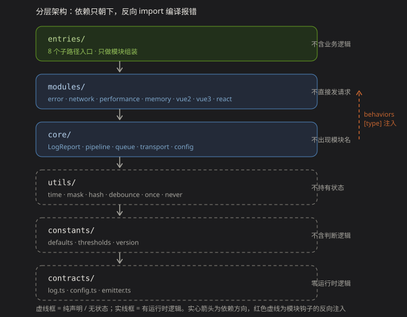
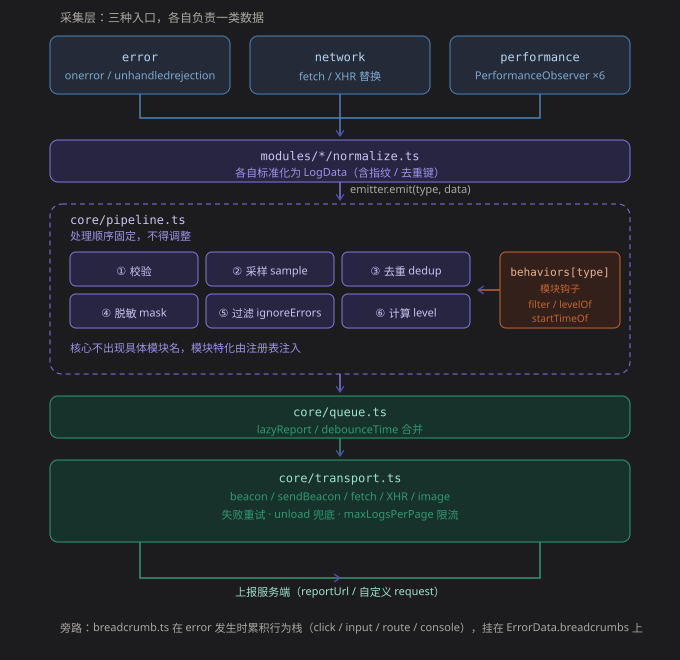
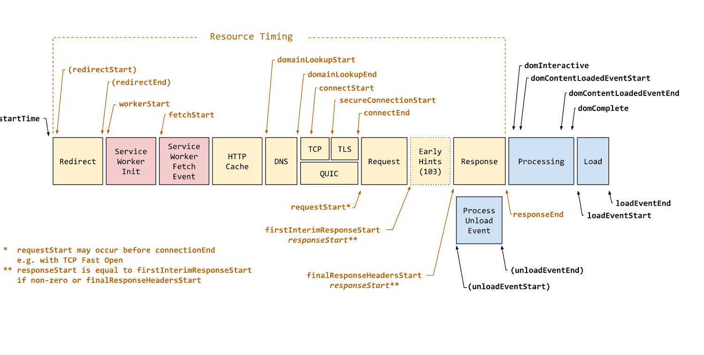

# monitor-report

前端监控组件：错误 / 性能 / 网络 / 内存各维度采集与上报的轻量 SDK。零运行时依赖，ES2018 目标，支持 ESM / CJS / IIFE 三种产物。

特性：

- 错误监控：JS 错误 / 资源加载失败 / Promise 未处理拒绝三通道采集，归一化指纹 + 计数式去重
- 性能监控：FCP / LCP / FID / INP / CLS 五项 Web Vitals + LT（长任务阻塞，诊断用），终态上报
- 网络监控：fetch / XMLHttpRequest 包装采集（可取消请求不误报），按状态码输出语义分类，400 / 401 / 404 不再混成「接口异常」
- 内存采样：JS 堆增长趋势（独立子路径，仅 Chromium）
- 数据脱敏：URL query / CSS 选择器 / 文本 PII 兜底脱敏（管道内强制执行）
- 体积敏感：按需引入子路径，core + error 约 5.7 kB（minified + brotli）

## 安装

```bash
npm install @yakult001/monitor-report
```

或通过 CDN 直接引入 UMD 产物（全局变量 `MonitorReport`）：

```html
<script src="https://unpkg.com/@yakult001/monitor-report/dist/index.global.js"></script>
<script>
  MonitorReport.createMonitor({ appId: 'demo', reportUrl: '/api/upload' })
</script>
```

## 快速开始

```ts
import { createMonitor } from '@yakult001/monitor-report'

const monitor = createMonitor({
  appId: 'project-web-001',
  reportUrl: 'https://report.example.com/api/upload',
  env: 'production',
  modules: ['error', 'performance', 'network'],
  release: '1.2.0'
})

// 延迟上报：首屏稳定后启动
requestIdleCallback(() => monitor.startReport())
```

按需引入（体积敏感场景）：

```ts
import { createMonitor } from '@yakult001/monitor-report/error' // 仅 core + 错误采集
import { createMonitor } from '@yakult001/monitor-report/performance' // 仅 core + 性能采集
import { createMonitor } from '@yakult001/monitor-report/network' // 仅 core + 网络采集
import { createMonitor } from '@yakult001/monitor-report/memory' // 仅 core + 内存采样
```

常用实例 API：

```ts
monitor.addReport('custom', { event: 'checkout_success' }) // 自定义上报
monitor.setUser('uid-001') // 设置用户标识
monitor.setTag('page', 'home') // 设置标签
monitor.setTraceId('trace-abc') // 设置链路 ID（透传字段）
monitor.setExtra({ from: 'landing_page' }) // 合并附加数据
monitor.flushReport() // 立即上报
monitor.getStatus() // 自诊断：{ queued, dropped, failed, disabled }
monitor.destroy() // 销毁（默认先 flush）
```

## 架构总览

本项目有两张图，**回答两个不同的问题**——不是重复，是互补：

| 图 | 回答什么 | 维度 |
| --- | --- | --- |
| **分层图** | 什么层干什么、边界在哪 | 代码组织（静态） |
| **数据流图** | 数据怎么被采集、处理、上报 | 运行时时序（动态） |

---

### 一、分层架构：代码怎么组织



依赖方向**只朝下**，反向 import 会编译报错：

| 层 | 目录 | 干什么 | **不干什么** | 依赖 |
| --- | --- | --- | --- | --- |
| 入口层 | `entries/` | 8 个子路径入口，组装模块集 | 不含业务逻辑 | modules |
| 能力层 | `modules/` | error / network / performance / memory / vue2 / vue3 / react | 不直接发请求 | contracts（core 经 context 注入） |
| 核心层 | `core/` | `LogReport`、pipeline、queue、transport、config | **不出现任何具体模块名** | 以上 |
| 工具层 | `utils/` | 无状态纯函数（时间 / 脱敏 / 哈希 / 防抖） | 不持有状态 | contracts, constants |
| 常量层 | `constants/` | 默认值、阈值表、入口清单 | 不含判断逻辑 | contracts |
| 契约层 | `contracts/` | 类型、配置类型、`emitter` 接口 | **零运行时逻辑** | — |

**边界怎么验证**：`contracts/` 不 import 任何层；`core/` 里搜不到 `if (type === 'network')` 这类判断（模块特化走 `behaviors[type]` 钩子）。加一个采集维度需要改 4 处声明（`LogDataMap`、`ModuleConfigMap`、`MODULE_DEFAULTS`、模块描述符 + `ALL_MODULES`），漏改会**编译报错**而不是静默失效。

> 图中的红色虚线是 `behaviors[type]` 注入——这是唯一允许的「反向」依赖形式，通过注册表在运行时注入，不构成 import 环。

---

### 二、数据流：运行时数据怎么走



从采集到上报是一条**单向数据流**，`core/pipeline.ts` 是它的中枢。

图中 `emitter.emit(type, data)` 那一条是**模块进入核心的唯一通道**：模块只能 emit 数据，不能直接访问 `queue` / `transport`，也不能自己发请求。这条约束保证了**所有数据都必须经过管道的校验 / 采样 / 去重 / 脱敏 / 过滤**，不存在绕开管道的旁路。

> 这里没有采用「订阅中心 + 回调数组」的事件总线：分发是**按 `LogType` 一对一直接路由**（`type` 本身就是路由键），不是一对多广播。消费者只有 `pipeline` 一个，加订阅表只会多一层遍历。

#### 三类采集入口

| 入口 | 机制 | 负责 |
| --- | --- | --- |
| **error** | `onerror` / `unhandledrejection` / 资源错误 / React ErrorBoundary | 错误 |
| **network** | `fetch` / `XMLHttpRequest` 替换 | 网络结果 |
| **performance** | `PerformanceObserver`（6 个 entryType）+ `requestAnimationFrame` | 性能指标 |
| **memory** | 定时器采样 | JS 堆用量 |

每类入口各自做 `normalize`，产出统一的 `LogData`（含指纹 / 去重键），再 `emitter.emit(type, data)` 交给管道。

#### 管道六步，顺序固定

```
① 校验  →  ② 采样  →  ③ 去重  →  ④ 脱敏  →  ⑤ 过滤  →  ⑥ 计算 level
```

顺序不可调换，理由在 `pipeline.ts` 顶部注释里写死：**采样必须在脱敏之前**（脱敏会改动内容、影响去重键），**脱敏必须在过滤之前**（`ignoreErrors` 的匹配要基于脱敏后的文本）。

#### 模块钩子：核心不出现具体模块名

管道只认 `LogType` 这个联合类型，模块特化全部由注册表注入：

```ts
behaviors[type] = {
  filter?:    (data, config) => boolean   // 忽略规则
  levelOf?:   (data) => LogLevel          // 级别映射
  startTimeOf?: (data) => number          // 事件起点
}
```

**好处是改动面可控**：新增采集维度时，只需改 4 处声明（`LogDataMap`、`ModuleConfigMap`、`MODULE_DEFAULTS`、模块描述符 + `ALL_MODULES`），漏改会**编译报错**而不是静默失效。

#### 与常见实现的差异

不少 SDK 把数据转换写成一个集中的 `transformData`（一个函数 `switch` 所有类型）。那样加类型就要改核心代码，且容易漏。本项目把这类逻辑**分散到各模块的 normalize 与 behaviors 钩子里**，核心只做通用的管道步骤。

`breadcrumb` 是旁路而非主干——它只在 error 发生时被读取，挂在 `ErrorData.breadcrumbs` 上，不独立上报。

## 框架集成

SDK 本身不依赖任何框架，框架错误通过适配插件接管。

**Vue 3 / Vue 2**

```ts
import { vueErrorPlugin } from '@yakult001/monitor-report/vue3' // vue2 用 /vue2
app.use(vueErrorPlugin, { monitor }) // Vue 2：Vue.use(...)
```

**React**

React 没有全局错误钩子，官方机制是 Error Boundary。SDK 提供工厂，把 React 传进去即可（避免本包依赖 react）：

```tsx
import { createErrorBoundary } from '@yakult001/monitor-report/react'

const Boundary = createErrorBoundary(React, monitor)

<Boundary fallback={<ErrorPage />} onError={(err, info) => console.warn(info)}>
  <App />
</Boundary>
```

覆盖范围要说清楚——boundary 只捕获**渲染、构造函数、生命周期**里的错误：

| 场景 | 谁来兜 |
| --- | --- |
| 渲染 / 生命周期抛错 | Error Boundary（`errorType: react_error`） |
| 事件处理器里抛错 | boundary 抓不到，走 `window.onerror`（`js_error`） |
| 异步代码（Promise / setTimeout） | `unhandledrejection` / `js_error` |

两条路互补，所以 React 项目里**两种都要接**：boundary 拿组件栈，全局通道兜住异步与事件。

## 日志级别

每条日志带 `level`，取值对齐 Sentry 的 event level（去掉了 `log` 档）：

```ts
type LogLevel = 'fatal' | 'error' | 'warning' | 'info' | 'debug'
```

级别由采集侧按确定性规则推导，**不需要逐条标注**；「某个故障多紧急」属于聚合后的优先级，由上报服务端计算（对齐 Sentry 的 issue priority High / Medium / Low），SDK 不做。

| 来源 | level |
| --- | --- |
| chunk 加载失败引发的 JS 错误 | `fatal` |
| 其他 JS 错误 / Promise 未处理 / Vue 组件错误 | `error` |
| 资源错误（`<script>` 失败） | `error` |
| 资源错误（图片 / 样式 / 媒体） | `warning` |
| 接口 5xx / 超时 / 网络层失败 | `error` |
| 接口 4xx / 重定向 | `warning` |
| 接口 2xx / 请求被取消 | `info` |
| 性能指标（评级 `poor` 时升 `warning`） | `info` |
| 内存采样（高占用或疑似泄漏时升 `warning`） | `info` |
| 自定义上报 | `info`（可由 `beforeSend` 覆写） |

```ts
createMonitor({
  appId: 'demo',
  reportUrl: '/api/upload',
  // 业务最清楚某条日志意味着什么，可以在这里改写级别
  beforeSend: (log) =>
    log.level === 'warning' && log.pagePath.startsWith('/checkout')
      ? { ...log, level: 'fatal' } // 结算链路上的 warning 按致命处理
      : log
})
```

## 性能指标的上报时机

七个指标里只有 FID 是「采集即上报」，其余默认都等到页面隐藏时结算——这是为了拿到 LCP / CLS / INP / LT 的**终值**，中途值没有统计意义。FPS 例外：它是采样型指标，采满 `fpsSampleDurationMs`（默认 10 秒）即结算上报，不等页面关闭。

`reportPerformanceOnHiddenOnly: false` 会让「能提前确定的指标」立即上报：

| 指标 | `true`（默认） | `false` |
| --- | --- | --- |
| FCP | 隐藏 / 兜底时上报 | **采集即上报** |
| LCP | 冻结时只记录，隐藏时上报 | **冻结即上报** |
| FID | 采集即上报 | 采集即上报 |
| CLS / INP / LT | 隐藏 / 兜底时结算 | 隐藏 / 兜底时结算（累积型指标） |
| **FPS** | **采样满 10s 即结算**，页面隐藏时也结算 | 同左 |

每个指标**只上报一次**，不会因为切换配置而重复。

### LCP 会在首次交互时冻结

`keydown` / `click` 一旦触发，LCP 观测立即停止（对齐 web-vitals 的 `stopListening`）。原因：LCP 候选的 `startTime` 是距 `timeOrigin` 的毫秒数，用户切到后台停留很久再回来时，浏览器可能再次 paint 并产出 `startTime = 380000` 这样的候选；不冻结就会把它当成最大 LCP 上报，几十万毫秒的假数据会把分位数直接打爆。

冻结只影响 LCP，CLS / INP 的观测继续运行。

### 每个指标的"终值"定义不同

七个指标不是同一类统计量，采集方式必须分别实现（前五个是 Core Web Vitals，`LT` 与 `FPS` 是诊断指标）：

| 指标 | 终值怎么算 |
| --- | --- |
| FCP | 第一个 `first-contentful-paint` 条目 |
| LCP | 全部候选中最大的 `startTime`（持续监听，不能拿到首个就断开） |
| FID | 首次输入的 `processingStart - startTime` |
| INP | 按 `interactionId` 聚合后取 **98 分位**（不取最大、不取平均） |
| CLS | **会话窗口**（相邻间隔 >1s 或距窗口开始 >5s 切窗）内的累加值取最大 |
| LT | 所有 `duration > 50ms` 任务的**总阻塞时长** `Σ max(0, duration - 50)`，附 `longTaskCount` / `maxLongTaskDuration` |
| FPS | 按秒分桶统计帧数，报**平均 FPS** 与 `fpsDropRate`（超过 33ms 的帧占比） |

`LT` 用来说明「卡顿有多少」，和 INP 互补：INP 只看**交互**相关的事件，LT 覆盖**包括非交互期间**的所有主线程长任务。它不计入 Core Web Vitals 达标率，阈值只是参考 Lighthouse 的 TBT 口径粗分档。

阈值（`good` / `needs-improvement` / `poor`）取自 Web Vitals，**只用于生成 `rating`，绝不用来过滤数据**——「慢」本身就是数据，客户端丢掉就永远不知道有多少人卡在那种状态。

LCP 上报时会带 `lcpElement`（最大内容元素的脱敏选择器），用于回答「是哪个元素慢」；浏览器未提供 `element`（如 bfcache 重放条目）时该字段缺省。

## 页面加载时间轴与各阶段差值

这是 HTML 规范 `PerformanceNavigationTiming` / `PerformanceResourceTiming` 的完整时间轴。**它决定了「页面慢」这个词能被拆成什么可归因的阶段**：



图上每个箭头指向一个**时间戳**（相对 `timeOrigin` 的毫秒数），而**相邻两个时间戳做差，就得到一个阶段的耗时**。

### 阶段划分

彩色方块是阶段，方块之间的边界就是时间戳：

| 阶段 | 起点 → 终点 | 说明 |
| --- | --- | --- |
| **Redirect** | `redirectStart` → `redirectEnd` | 301/302 跳转。带括号表示**可选**，没有重定向时为 `0` |
| **Service Worker Init / Fetch** | `workerStart` → `fetchStart` | Service Worker 启动并拦截请求 |
| **HTTP Cache** | `fetchStart` → `domainLookupStart` | 先查内存/磁盘缓存，命中就结束 |
| **DNS** | `domainLookupStart` → `domainLookupEnd` | 域名解析成 IP |
| **TCP / TLS / QUIC** | `connectStart` → `connectEnd` | 三次握手；HTTPS 还含 TLS 握手（`secureConnectionStart` 在中间） |
| **Request** | `requestStart` → `responseStart` | 请求发出 → 收到第一个字节（这段时间服务器在处理） |
| **Early Hints (103)** | `firstInterimResponseStart` | 服务器先发 `103` 提示预加载，再发正式响应（较新的特性） |
| **Response** | `responseStart` → `responseEnd` | 响应体传输 |
| **Process Unload** | `unloadEventStart` → `unloadEventEnd` | 卸载上一个页面 |
| **Processing** | `responseEnd` → `domInteractive` | HTML 解析、执行同步脚本 |
| **Load** | `domInteractive` → `loadEventEnd` | 图片、样式等资源加载完成 |

### 时间戳清单

| 时间戳 | 含义 | 备注 |
| --- | --- | --- |
| `startTime` | 导航开始（通常为 `0`） | 一切的原点 |
| `redirectStart` / `redirectEnd` | 重定向期间 | 没发生重定向时都是 `0` |
| `workerStart` | Service Worker 启动 | 无 SW 时为 `0` |
| `fetchStart` | 开始查找资源 | 缓存命中时，后面的时间戳可能都是 `0` |
| `domainLookupStart` / `domainLookupEnd` | DNS 解析 | 连接复用时为 `0` |
| `connectStart` / `connectEnd` | 连接建立 | 同上 |
| `secureConnectionStart` | TLS 握手开始 | 仅 HTTPS；纯 HTTP 为 `0` |
| `requestStart` | 发送 HTTP 请求 | **可能早于 `connectEnd`**（TCP Fast Open） |
| `firstInterimResponseStart` | 收到 `103 Early Hints` | 无 Early Hints 时为 `0` |
| `responseStart` | 收到第一个字节 | **见下方注解** |
| `responseEnd` | 收到最后一个字节 | |
| `unloadEventStart` / `unloadEventEnd` | 前一个页面的 `unload` | 没有前页面时为 `0` |
| `domInteractive` | DOM 解析完成（`readyState = interactive`） | 此时可执行 DCL 逻辑 |
| `domContentLoadedEventStart` / `End` | `DOMContentLoaded` 事件 | |
| `domComplete` | `readyState = complete` | |
| `loadEventStart` / `loadEventEnd` | `load` 事件 | **事件未触发前都是 `0`** |

### 做差的意义：把「页面慢」拆开归因

单看 `loadEventEnd = 3200ms` 没有任何信息量。**做差之后才知道该优化哪里**：

| 指标 | 公式 | 归因到什么 | 典型优化方向 |
| --- | --- | --- | --- |
| **TTFB** | `responseStart - startTime` | **服务器响应速度** | CDN、接口合并、服务端耗时 |
| DNS 解析 | `domainLookupEnd - domainLookupStart` | 域名解析 | DNS 预解析、减少域名数 |
| TCP 建连 | `connectEnd - connectStart` | 连接建立 | 长连接、HTTP/2/3 |
| TLS 握手 | `connectEnd - secureConnectionStart` | HTTPS 握手 | TLS 1.3、会话恢复 |
| **服务器处理** | `responseStart - requestStart` | 服务器侧（不含传输） | 服务端性能 |
| **内容下载** | `responseEnd - responseStart` | 响应体传输 | 压缩、HTTP/2 多路复用、减体积 |
| **DOM 解析** | `domInteractive - responseEnd` | HTML 解析 + 同步脚本 | 减少同步 JS、减小 HTML |
| **DCL 总耗时** | `domContentLoadedEventEnd - startTime` | DOM 可交互时刻 | 阻塞脚本、内联 CSS |
| **资源加载** | `loadEventStart - domContentLoadedEventEnd` | 等图片/字体/样式 | 图片懒加载、预加载 |
| **页面总耗时** | `loadEventEnd - startTime` | 全程 | 以上各项之和 |

> **`TTFB` 是这些差值里最被重视的一项**，Google 的 CrUX 也直接收录它作为参考指标。当线上有人反馈「页面白屏」时，第一件该看的就是 TTFB——它把问题分成「服务器慢」还是「前端慢」。

### 三个容易踩的坑

**① `responseStart` 的定义被 `103 Early Hints` 改过**

图下角注释的含义是：如果服务器先发了 `103 Early Hints`，`responseStart` **等于 `firstInterimResponseStart`**；否则等于 `finalResponseHeadersStart`。也就是 `responseStart` 不再严格等于“第一个正式字节”，而可能是“第一个先遣响应”。

**② `requestStart` 可能早于 `connectEnd`**

TCP Fast Open 下，客户端可以在连接建立完成前就发数据。所以上面的“服务器处理”公式有可能是负数——这是正常的，不要当异常处理。

**③ `0` 不等于「没耗时」，而是「这个阶段没发生或还没到」**

- `loadEventStart` 在 `load` 事件没触发前读，永远是 `0`
- `redirectEnd` 在无跳转时是 `0`，而不是“跳转用了 0ms”
- 直接拿 `0` 做差会得到负值，**必须先判 `0`**

### 与我们采集指标的关系

这张图上**我们只采集其中一小部分**：

| 时间轴上的点 | 我们采吗 | 说明 |
| --- | --- | --- |
| TTFB | ❌ **没采** | 它是服务端指标，且要和服务端监控对齐才有意义 |
| DNS / TCP / TLS | ❌ | 网络层细节，与用户体验相关性弱 |
| `domInteractive` / DCL | ❌ | 已被 FCP / LCP 更好地覆盖 |
| **FCP** | ✅ | 第一次渲染，约在 `domInteractive` 附近 |
| **LCP** | ✅ | 可能**晚于 `load`**（懒加载大图） |
| **FID** | ✅ | 首次输入的响应延迟，与这张图无关 |
| **CLS / INP / LT** | ✅ | **与这张图无关**，是 `load` 之后持续产生的 |

**关键区别**：这张时间轴描述的是**加载期**（loading），而我们的指标覆盖的是**整个生命周期**（含 load 之后的交互期）。两者是互补关系，不能互相替代——`loadEventEnd` 早不代表体验好，因为卡顿发生在 load 之后的交互里。

## FPS：帧率统计

`LT` 测「主线程被占多久」，`FPS` 测「画面是否流畅」。两者互补：**5 个 40ms 任务全都在 Long Task 阈值以下（LT 不记录），但可能连掉 12 帧**——这种情况只有 FPS 能看见。

### 采集方式

`requestAnimationFrame` 打点 + **按秒分桶**：

```ts
每帧回调 → delta = now - lastFrameTime
每 1 秒 → 把这一秒的帧数记为一个 FPS 样本
结算时 → 各秒样本的平均值
```

用 `performance.now()`（单调递增），**不是** `Date.now()`——后者受系统时钟调整影响（NTP 校准、用户改时间），会让 `delta` 变成负数。

### 上报三个字段

| 字段 | 含义 |
| --- | --- |
| `value` | 平均 FPS（各秒样本的平均） |
| **`fpsDropRate`** | **掉帧率 0-1**：超过 33ms 的帧占比 |
| `maxFrameDuration` | 最长单帧间隔 ms（定位最卡的时刻） |

**为什么不能只报平均 FPS**：帧率在 60 和 30 之间反复跳，平均是 45、看着还行，但体验已经崩了。`fpsDropRate` 直接反映这种长尾。

### 三个必须处理的坑

**① 页面隐藏时 rAF 会停止，但时钟继续走**

切后台 30 秒后回来，首帧 `delta = 30000ms`，会算出 `FPS ≈ 0.03` 的假值。**必须在 `visibilitychange` 时 `pause()` / `resume()`**，跳过不可见期间的空档。

**② `resume()` 要清空当前桶的计数**

否则 `pause` 前残留的帧数会被算进 `resume` 后的第一个样本，导致 FPS 偏高。

**③ 采样期间不要在回调里做任何分配**

rAF 每 16.7ms 调用一次，回调里只做一次减法与两次比较；不做 DOM、不拼字符串、不建对象。观测者本身不能造成卡顿。

### 默认关闭

`performance.fpsEnabled: true` 开启。默认关的原因：**rAF 持续运行会阻止浏览器进入低功耗模式**，移动端有电量影响；且不是所有场景都需要测帧率。

```ts
createMonitor({
  appId: 'your-app-id',
  reportUrl: 'https://your-domain/collect',
  performance: { fpsEnabled: true, fpsSampleDurationMs: 15000 }
})
```

### 阈值与判定

`rating` 阈值（`good ≥ 50` / `needs-improvement ≥ 30`）**参考游戏与视频行业的经验值，不是 W3C 标准**。掉帧判定用 **33ms**（60Hz 下连续掉 2 帧）。

> FPS 是唯一「**越高越好**」的指标，`getRating` 对它做了方向反转；其余指标都是「越低越好」。

## 错误上下文：行为栈

错误上报时会附带一段**行为栈**（breadcrumb），用于还原「用户做了什么才触发这个错误」。它不独立上报，只在错误日志里出现：

```json
{
  "errorType": "js_error",
  "message": "Cannot read properties of undefined (reading 'id')",
  "breadcrumbs": [
    { "timestamp": 1793073476217, "category": "ui.click", "level": "info",
      "message": "click button#submit.primary", "data": { "selector": "button:nth-child(2)", "id": "submit", "class": "primary", "text": "提交订单", "attrs": { "data-track": "pay" } } }
  ]
}
```

几个刻意的取舍：

- **记的是被点击的元素**（`composedPath()[0]`，兼容 shadow DOM），不是当前聚焦元素
- **同元素 500ms 内的连点合并为一条**，带 `count`，不刷屏
- **隐私**：文本截断 30 字并脱敏邮箱/手机号/身份证，`href` 去掉 query，**永不读取输入内容**；`input` / `textarea` / `select` 连 `textContent` 都不取
- **快照在错误发生的那一刻取**，不是上报时取（上报可能延迟数秒）

除了点击，还记录两类行为：

| `category` | 触发 | 说明 |
| --- | --- | --- |
| `ui.click` | 任意点击 | 元素选择器 / id / class / 文本 / `data-*` |
| `ui.input` | 表单控件聚焦 | 同上但**不含文本**，只带 `type`（`password` 之类） |
| `navigation` | 路由变化 | `{ from, to, kind }`，`kind` 为 `pushState` / `replaceState` / `popstate` / `hashchange` |
| `console` | `console.warn` / `error` / `assert` | 参数经安全序列化（循环引用不抛错）+ 脱敏 |

**路由不需要判断模式**：SDK 把四个来源全接上，把「这次跳转由谁触发」记进 `kind`，history 还是 hash 由报表端自己归类。`from === to` 不记录，query 里的值默认打码（`maskQueryKeys` 可放行指定键）。

容量由 `maxBreadcrumbs` 控制（默认 20，设为 `0` 时连监听都不注册）。默认值比 Sentry 的 100 小，是因为要照顾 `sendBeacon` / keepalive 的 60KB 上限。

### console 只记 warn 及以上

`console.error` / `warn` 是「被 `try/catch` 吞掉的错误」的最后痕迹——这类错误 `window.onerror` 看不到，只能靠行为栈还原。所以默认劫持这三个级别：

```ts
createMonitor({
  appId: 'demo',
  reportUrl: '/api/upload',
  consoleBreadcrumb: 'warn' // 'off' | 'error' | 'warn'（默认）| 'all'
})
```

`log` / `info` / `debug` 默认不记：量大、隐私风险高、排障价值低。参数会先经安全序列化（循环引用、DOM、大对象都有兜底），再过 PII 脱敏，最后截断到 160 字。

## 网络请求的状态码分类

网络日志除了原始 `resStatus`，还带 `statusCategory` 与 `statusMessage` 两个字段，避免下游把一切失败统一渲染成「接口异常」：

| 状态码 | `statusCategory` | 典型原因 |
| --- | --- | --- |
| 2xx | `success` | —— |
| 3xx | `redirect` | 重定向未被跟随 / 接口地址被改写 |
| 400 | `bad_request` | 前端传参字段或序列化错误 |
| 401 | `unauthorized` | 未登录、token 过期或刷新逻辑失效（前端最高频事故） |
| 403 | `forbidden` | 账号权限不足、白名单或风控拦截 |
| 404 | `not_found` | URL 拼写错误、前后端接口版本不匹配 |
| 405 / 409 / 413 / 422 / 429 | `client_error` | 方法用错 / 并发冲突 / 体积超限 / 校验失败 / 触发限流 |
| 5xx | `server_error` | 后端故障（501 / 502 / 503 / 504 有独立文案） |
| 无状态码且请求失败 | `network_error` | 断网、CORS 拦截、插件阻断 |
| 超时 | `timeout` | 服务端未在约定时间内响应 |
| 主动取消 | `aborted` | `AbortController` / `xhr.abort()`，**不计为失败** |

`resOk` 的判定统一收在内部（2xx 为 `true`，其余为 `false`，取消为 `true`），fetch 与 XHR 两条通道语义一致。需要在自己的上报展示层复用同一套分类时，可以直接引用：

```ts
import { classifyNetworkOutcome } from '@yakult001/monitor-report' // 或 /network 子路径

const out = classifyNetworkOutcome({ resStatus: 401, aborted: false })
// { resOk: false, statusCategory: 'unauthorized', statusMessage: '未登录或凭证已失效（401）…' }
```

## 部署要求

### SSR / Nuxt

SDK 依赖浏览器全局对象，必须只在 client 侧初始化（构造函数已做环境守卫，非浏览器环境会静默降级为 no-op，但请勿在服务端 import 后于模块顶层执行副作用）：

```ts
// plugins/monitor.client.ts —— 只放 client 侧
import { createMonitor } from '@yakult001/monitor-report'

export default defineNuxtPlugin(() => {
  const monitor = createMonitor({ appId: 'nuxt-web', reportUrl: '/api/upload' })
  return { provide: { monitor } }
})
```

### 跨域脚本错误（crossorigin）

浏览器对跨域脚本默认只抛出 `Script error.`（无 message / stack / 行号）。要采集到真实错误信息，业务方必须：

1. 给 `<script>` 加 `crossorigin` 属性（`crossorigin="anonymous"`）；
2. CDN 返回 `Access-Control-Allow-Origin` 响应头。

否则 SDK 只能上报 `crossOrigin: true`、`fileName: 'unknown-cross-origin'` 的降级信息。

### sendBeacon 鉴权限制

卸载上报的优先链路是 `fetch(..., { keepalive: true })`（可携带自定义请求头）；当批次体积超过 60KB 或 keepalive 不可用时降级为 `navigator.sendBeacon`，**该路径无法携带自定义请求头**。如后端依赖鉴权信息，请：

- 使用 `extra: { token: '...' }` 配置 token —— SDK 会把它随体放在上报体顶层 `token` 字段，两种传输路径均可用；
- 或在下载路径之外自行保证鉴权在 body / URL 中。

> `requestConfig.headers` 只作用于常规上报与 keepalive 路径；sendBeacon 降级路径不带 header。

### 自定义传输（request）

配置 `request: (logs) => ...` 会**完全替换**内置传输逻辑（不再走队列重试）。此模式下失去内置卸载兜底，请同时提供 `unloadRequest`，否则卸载时的批次会被跳过并计入 dropped 计数。

### 像素信标（image）上报

`transport: 'image'` 会把上报改成 `new Image()` 发 GET：

```ts
createMonitor({ appId: 'demo', reportUrl: '/api/upload', transport: 'image' })
```

这个 GET 是 `no-cors` 模式——**不需要服务端返回 `Access-Control-Allow-Origin`**，也不需要预检。数据能送到。

**适用场景**：服务端无法配置 CORS，或 `fetch` / `sendBeacon` 都不可用的环境。

**三个必须知道的限制**：

| 限制 | 影响 |
| --- | --- |
| **只能 GET** | 数据进 URL query，上限 2000 字节。**按条分批发送**（接近上限就发一批），单条仍超长时截断 `stack` 到 500 字符 |
| **读不到响应** | 无法判断成败、**不重试**，只能乐观计为已发送 |
| **不能带自定义 header** | 鉴权靠 cookie 或 URL 参数（`extra: { token }` 会随体放在上报体顶层） |

**关于超长处理**：不会按字节切 JSON 分片——分片需要服务端实现重组协议，而 SDK 单方面拆会让服务端把 3 个分片当成 3 条残缺数据。所以这里按**条**拆批：每条请求都是一份完整数据，服务端不需要任何配合。只有单条自身就超长时，才截断 `stack`（保留 `type` / `message` / `level` 等核心字段），截断后仍超长才丢弃并计入 `dropped`。

因为 URL 长度受限，image 模式适合**低频、小体积**的上报；大流量场景请用默认的 `fetch`。

## 关于 sourcemap

**npm 包里不含 `.map` 文件**，这是有意为之：

- 接入方定位自己代码的报错**不需要**本包的 map —— sourcemap 反解逐帧独立，业务帧由业务自己的 map 还原，本包缺 map 不会让业务帧退化
- 去掉 map 后 tarball 从 524 KB 降到约 90 KB
- 构建产物 `dist/` 里仍完整保留 map，作为 GitHub Release 附件发布

如果确实需要连 SDK 内部帧一起还原（例如排查 SDK 自身的报错），从对应版本的 Release 下载 map，按上报平台的 sourcemap 上传流程使用。注意 `dist` 里的 js 已在发布前移除 `//# sourceMappingURL` 注释，所以浏览器 devtools **不会**自动加载 map。

## 接入方责任

`extra` / `tags` / `custom` 类型数据由宿主自行构造，SDK **不递归清洗**这类字段，请勿在其中承载任何个人身份信息（邮箱、手机号、身份证号等 PII）。开启 `debug: true` 时，SDK 检测到上述字段疑似含 PII 会打印 warning。

## 已知边界

1. `performance.memory` 仅 Chromium 有效，数值经量化（约 100KB 粒度），只覆盖 JS 堆（不含 DOM / CSS / GPU / Worker）。
2. `sendBeacon` 降级路径无法携带自定义请求头，鉴权信息须在 body 或 URL 中（见上文）。
3. 跨域脚本错误需要业务方为 `<script>` 加 `crossorigin` 且 CDN 返回 `Access-Control-Allow-Origin`，否则退化为 `Script error.`。
4. 使用自定义 `request` 时失去内置卸载兜底，需自行实现 `unloadRequest`。
5. 本期不做会话回放、路径回溯、Source Map 反解、白屏检测。

## 本地开发

```bash
npm run ci          # lint + typecheck + test + build + size 全量校验
npm run test:watch  # 监听模式跑单测
npm run size        # 体积上限校验
```