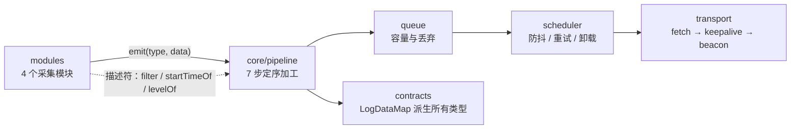
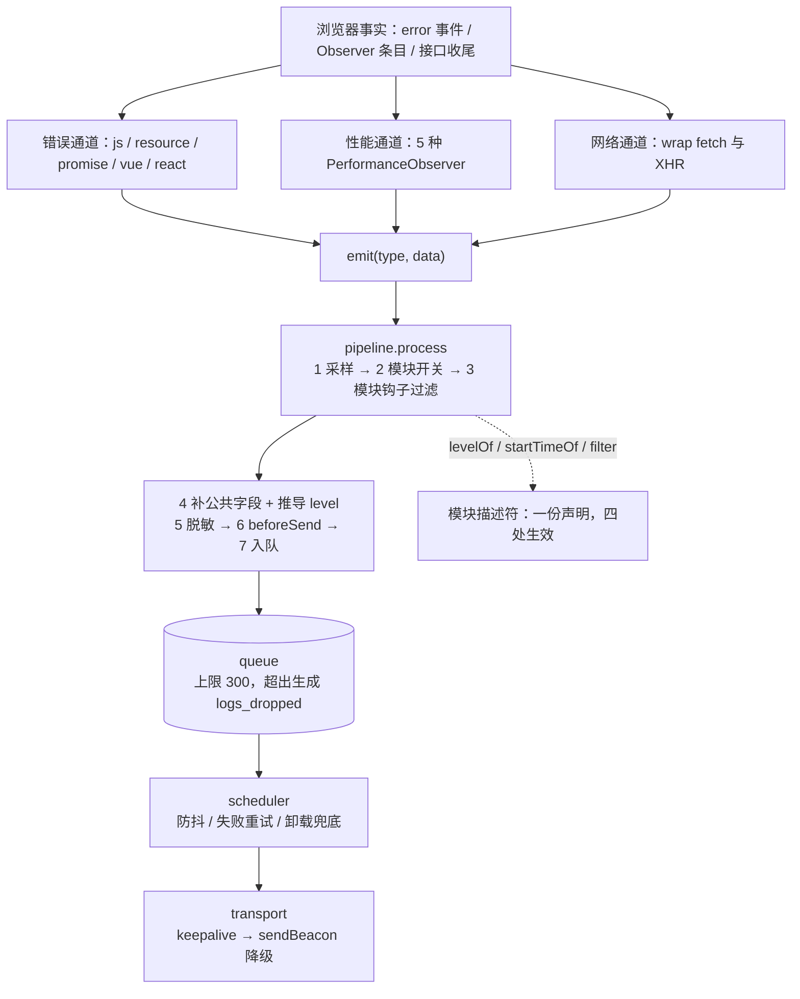
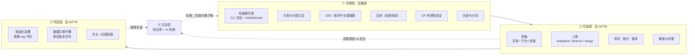

# 监控 SDK 主线叙事（面试用）

> 用途：这是所有细节的**挂载点**。先讲这一版，面试官追问哪个点，再展开对应章节。
> 姊妹文档：`docs/项目复盘-监控SDK.md`（复盘长文，讲"我踩了什么坑"）；本文是**面试交付版**，讲"怎么讲"。
> 时长标注：`[30s]` 电梯稿、`[3min]` 标准版、`[8min]` 深挖版。

---

## 目录 <a id="toc"></a>

> 全部可点击跳转。破折号后是建议讲解时长 / 提示。每章标题下方都有「↑ 返回目录」。

- [一、电梯稿](#sec-1) — 30s
- [二、标准版](#sec-2) — 3min
  - [1. 是什么](#sec-2-1)
  - [2. 架构](#sec-2-2)
  - [3. 三个难点](#sec-2-3)
  - [4. 结果](#sec-2-4)
- [三、核心架构：五段怎么咬合](#sec-3) — 5min
  - [3.1 一句话概括](#sec-3-1)
  - [3.2 数据流全景](#sec-3-2)
  - [3.3 五段各自职责与边界](#sec-3-3)
  - [3.4 六个关键设计决策](#sec-3-4) — 重点
  - [3.5 怎么防止结构再退化](#sec-3-5)
  - [3.6 一句话收口](#sec-3-6)
- [四、深挖版](#sec-4) — 8min
  - [难点 1：成功率 99.8% 而在炸](#case-1)
  - [难点 2：一个能力散在 11 个文件](#case-2)
  - [难点 3：LCP 变成三十万毫秒](#case-3)
  - [难点 4：行为栈里全是 body](#case-4)
  - [难点 5：本地 tsc 过 CI 报错](#case-5)
  - [难点 6：五个指标的终值定义各不相同](#case-6) — 设计题
- [五、讲法提示](#sec-5)
  - [要留的钩子](#sec-5-1)
  - [不建议主动讲的](#sec-5-2)
  - [如果被问"代码是你写的吗"](#sec-5-3)
  - [五种时长怎么裁](#sec-5-4)
- [六、可引用的硬指标](#sec-6)
- [七、竞品定位：对标 Sentry](#sec-7) — 高频
  - [7.1 一句话定位](#sec-7-1)
  - [7.2 它是什么](#sec-7-2)
  - [7.3 形态差异](#sec-7-3)
  - [7.4 字段级不对称](#sec-7-4) — 主动讲
  - [7.5 三个必被追问的问题](#sec-7-5)
  - [7.6 输出一句判断](#sec-7-6)
- [八、体系题：稳定性三根支柱](#sec-8) — 8min
  - [8.1 电梯稿](#sec-8-1) — 40s
  - [8.2 全景图](#sec-8-2)
  - [8.3 可预防：六个动作](#sec-8-3)
  - [8.4 可监控：四段流水线](#sec-8-4)
  - [8.5 可回滚：数据不能](#sec-8-5)
  - [8.6 沉淀层：AI 与知识库](#sec-8-6) — 加分
  - [8.7 三个必被追问的问题](#sec-8-7)
  - [8.8 输出一句判断](#sec-8-8)
  - [8.9 稳定性专题速查 13 条](#sec-8-9)
- [九、深问点速查 16 条](#sec-9)
- [十、天花板与诚实边界](#sec-10) — 被问短板
- [附、一句话版本](#sec-app)

---

## 一、电梯稿 [30s] <a id="sec-1"></a>

[↑ 返回目录](#toc)

> 我做了一个前端监控 SDK，采集错误、性能、网络、内存四个维度，发到 npm 上，带按需引入和多框架适配。
>
> 但**真正的难点不是采集**——把 `window.onerror` 挂上、把 `PerformanceObserver` 起来，这些半天就能做完。
> 难的是让采集到的数据**可被信任**：我遇到过面板显示接口成功率 99.8%、而线上正在大面积报 500 的情况。

讲完停在这里。"难点不是采集，是让数据可被信任"是刻意的钩子，多数面试官会追问"怎么会记错"。

---

## 二、标准版 [3min] <a id="sec-2"></a>

[↑ 返回目录](#toc)

### 1. 是什么（30s） <a id="sec-2-1"></a>

一个**零运行时依赖**的浏览器监控 SDK，四个采集维度 + 四个横切能力：

| 维度 | 内容 |
| --- | --- |
| 错误 | JS / Promise / 资源 / 框架（Vue2、Vue3、React） |
| 性能 | FCP / LCP / FID / INP / CLS，Web Vitals 评级 |
| 网络 | fetch + XHR，状态码语义分类 |
| 内存 | Chromium 堆采样，增长检测 |

横切能力：日志分级（5 档）、行为栈（4 类来源）、公共字段与脱敏、批量调度与卸载传输。

### 2. 架构（40s，展开见 §三） <a id="sec-2-2"></a>



关键抽象是**模块描述符**：模块不只需要一个工厂函数，还要声明自己的过滤规则、事件起点、级别映射。核心管道只消费这些钩子，**`core/` 里不出现任何具体模块名**。

### 3. 三个难点（90s，每个 30s，详见 §四） <a id="sec-2-3"></a>

1. **浏览器 API 的语义陷阱**：XHR 的 4xx/5xx 不触发 `error` 事件，"没报错"不等于"成功了"。
2. **结构性债务**：一个采集能力散在 11 个文件里，漏改一处不报错、静默失效。
3. **性能指标的假数据**：用户切后台再回来，LCP 会是几十万毫秒。

### 4. 结果（20s） <a id="sec-2-4"></a>

45 个源文件 / 4369 行，8 个导出入口，**214 个测试**，`core + error` ≈7.8 kB（预算 10 kB），已在 npm 上以 OIDC + provenance 自动发布。

---

## 三、核心架构：五段怎么咬合 [重点，可独立讲 5min] <a id="sec-3"></a>

[↑ 返回目录](#toc)

这一章回答的是"这套东西凭什么能被复用、能被测试、能换框架、能保证数据正确"。**它比任何单个难点都更能体现架构能力**。

### 3.1 一句话概括 <a id="sec-3-1"></a>

> **模块负责「从浏览器里框出事实」，管道负责「把事实定序加工成一条日志」，  
> 队列负责「装得下多少」，调度负责「什么时候发、失败怎么办」，传输负责「用什么姿势送出去」。**
>
> 五段单向依赖，**每段都不做下一段的事**。

### 3.2 数据流全景 <a id="sec-3-2"></a>



### 3.3 五段各自的职责与边界 <a id="sec-3-3"></a>

| 段 | 职责（只做这一件事） | 明确不做 |
| --- | --- | --- |
| **模块** | 把浏览器事实转成归一化数据；声明 `filter` / `startTimeOf` / `levelOf` | 不判采样、不补公共字段、不脱敏、不发请求 |
| **管道** | 7 步**定序**处理：采样 → 开关 → 钩子过滤 → 补字段与 level → 脱敏 → `beforeSend` → 入队 | 不认识任何具体模块；不决定何时上报 |
| **队列** | 容量上限、丢弃计数、`logs_dropped` 通知 | 不做优先级、不重排 |
| **调度** | 防抖批量、失败回塞重试、`visibilitychange`/`pagehide` 卸载通道 | 不关心日志内容 |
| **传输** | 传输方式降级链、体积上限保护 | 不知道数据语义 |

### 3.4 六个关键设计决策（面试真正要讲的部分） <a id="sec-3-4"></a>

#### ① 采集与加工分离

模块只产出「事实」，一切加工进管道定序执行。这条分离的直接好处是**顺序可测**：采样在过滤之前、脱敏在 `beforeSend` 之前，这些顺序一旦写死在管道里，就不会被某个模块的自定义逻辑绕过去。

反例很常见：模块自己在 `emit` 前就 `JSON.stringify` 或截断，导致管道拿到的已经不是原始数据，脱敏被迫在更下游做，漏一个字段就泄一次。

#### ② 模块自描述：把「记得改」变成「必须改」

```ts
export const networkModule = defineModule({
  type: 'network',
  create: createNetworkMonitor,
  filter: (data, config) => matchesBlacklist(data.reqUrl, config.urlBlacklist),
  startTimeOf: (data) => data.reqStartTime,
  levelOf: levelOfNetwork
})
```

核心侧只消费 `ModuleRegistry` 与 `behaviorsOf(registry)`。收益有两个：

- **`core/` 里不再出现 `'network'` 这个字符串**——新增模块不需要动核心。
- 类型擦除只发生在 `defineModule` 内部一处，调用侧拿到的 `data` 是按模块收窄的。

#### ③ 分级：event level 与 issue priority 分工

- **事件级 `level`**（fatal / error / warning / info / debug）：单条日志多严重，采集侧按事实确定性推导，**不需要业务方标注**。
- **问题级 priority**（High / Medium / Low）：聚合后由频次、影响用户数、是否关键路径计算，**属于上报服务端，SDK 不做**。

SDK 的职责边界就一句话：把 `count` / `firstSeen` / `lastSeen` / `sessionId` / `fingerprint` 给全。

#### ④ 类型映射表：把同步义务变成编译错误

```ts
export interface LogDataMap {
  error: ErrorData
  performance: PerformanceData
  network: NetworkData
  memory: MemoryData
  custom: Record<string, unknown>
}
export type LogType = keyof LogDataMap            // 自动派生
export type LogDataOf<T extends LogType> = LogDataMap[T]
export type ReportLog = { [K in LogType]: LogBase & { type: K; data: LogDataMap[K] } }[LogType]
```

原来 `LogType`、五个 `XxxLog`、`ReportLog`、`LogDataOf` 共 5 处手工同步；改成一个映射表之后，新增维度只加一行，**漏改直接编译失败**。

#### ⑤ 配置不是状态

注册表、行为表、`beforeSend`、`sample` 全是注入的**配置**，不进运行时状态，`destroy()` 不用回滚它们。这样"引擎怎么工作"与"这次采集到了什么"彻底分开——**重置数据不会把引擎配置一起清掉**。

#### ⑥ 框架适配：不 import 框架，让宿主注入

Vue 好办，`config.errorHandler` 挂上去即可；React 没有全局钩子，官方机制是 Error Boundary，而 boundary **必须 `extends React.Component`**。

这里做了个刻意选择：**SDK 不 import 任何框架**，Vue / React 实例都由宿主传进来：

```ts
const Boundary = createErrorBoundary(React, monitor)   // React 作为参数注入
<Boundary fallback={<ErrorPage />}>{children}</Boundary>
```

好处有三个：包保持零框架依赖（`monitor-report/react` 不会把 react 拖进依赖图）、`fallback` 由宿主用 JSX 建好传入所以**不用调 `createElement`**（插件是纯 `.ts`）、测试不需要安装框架。

代价是类型只能给到结构类型（`ReactLike { Component }`），拿不到完整的 React 类型推导——这是"零依赖"的必然交换。

同时必须说清覆盖边界：boundary 只捕渲染 / 构造函数 / 生命周期；事件处理器与异步错误仍走 `js_error` / `promise_error`。**两条路要都接，互补不重叠。**

### 3.5 最容易被追问的细节：结构改完，怎么防止再退化 <a id="sec-3-5"></a>

重构完最大的风险是「三个月后又长回去」。所以补了三道机制：

| 机制 | 防什么 | 怎么验证 |
| --- | --- | --- |
| `core/` 不得出现模块名 | 特化分支回流 | 代码评审 + 描述符只有三个钩子，想加分支得先改契约 |
| 新增维度只改 4 处声明 | 声明散落 | 少改任何一处都是编译错误 |
| 子路径入口不得 import 全量清单 | tree-shaking 失效 | 断言 `dist/error.js` 不含 `NetworkMonitor` / `XMLHttpRequest` |

最后一条不是洁癖：它是**产物正确性**问题——`monitor-report/error` 如果被打进网络模块代码，按需引入就是假的。

### 3.6 一句话收口（如果面试官只记住一句） <a id="sec-3-6"></a>

> 这套东西能扛住"浏览器 API 到处都是坑"，是因为**分成"采集 → 加工 → 缓冲 → 调度 → 传输"五段，每段都能单独测、单独换**。  
> 一个新模块再怎么写错，也只会污染第一段；后面四段的行为是确定的。

---

## 四、深挖版 [8min] <a id="sec-4"></a>

[↑ 返回目录](#toc)

每个难点讲四段：**现象 → 归因 → 解法 → 代价**。代价那一段是区分"能讲"和"真做过"的地方。

### 难点 1：成功率 99.8%，而线上正在炸 [2min] <a id="case-1"></a>

**现象**：自建面板显示接口成功率 99.8%，同期客服反馈下单没反应，抓包是 500。

**归因**：XHR 判定写的是「没触发 `error` 事件就算成功」。而 `error` 只在**传输层失败**时触发（DNS、连接被拒、断网、CORS 拦截）；4xx/5xx 是完整收到响应，走 `load` → `loadend`。于是 404 和 500 全被记成成功。

更难堪的是：同一个包里 fetch 通道用的是 `res.ok`，语义相反。同一个后端错误，axios 记成功、fetch 记失败。

**解法**：判据只留状态码，且**顺序固定**：

```
先看是否主动取消 → 再看超时 / 网络层错误 → 最后看状态码
```

顺序反了会把「用户切页导致的取消」记成失败（取消时 `status` 是 0），把失败率抬起来。配套补了 `statusCategory`（11 类）与 `statusMessage`，以及两个认知：`status === 0` 至少有三种成因；304 是缓存命中但 `res.ok === false`。

**代价**：这是一次**契约变更**——历史数据没有 `statusCategory`。而且修好之后面板上的成功率**会变难看**（原来虚高），得先跟用数据的人打招呼。这个代价我当时没预料到，是被问"那你的看板要重新解释一遍吧"才意识到的。

---

### 难点 2：一个采集能力散在 11 个文件里 [2min] <a id="case-2"></a>

**现象**：给网络监控加一个字段，要改 11 个文件：类型、配置契约、默认值、配置合并、管道特化分支、核心重放 switch、子路径注册表、全量装配表、根级入口、构建入口、`package.json#exports`。

**归因**：目录按**技术角色**切（contracts / core / modules / entries），而真正会变的是**能力**。一个能力必须穿透所有层，每层留一份声明；漏改其中一处（比如管道里的 `if (type === 'network')`）不会报错，只会静默失效。

**解法**：先把"结构有点乱"换成两个可验收的判据——**新增改几处、漏改报不报错**——然后三步走：类型收敛成映射表、能力自描述 + 核心只认接口、入口收敛成单一事实源。

**代价**：抽象有成本。只有一个模块时上描述符是纯粹的负担，读代码的人要多跳一层。所以我们是**等到第三个模块要加 level 钩子时才动的手**，不是一开始就设计成现在这样。

**结果**：11 处 → 4 处，且漏改编译报错。

---

### 难点 3：切到后台三十秒，LCP 变成三十万毫秒 [2min] <a id="case-3"></a>

**现象**：有用户上报的 LCP 是 380000ms，把分位数直接打爆。

**归因**：LCP 候选的 `startTime` 是**距 `timeOrigin` 的毫秒数**，后台停留时间天然被算进去。我们只在页面隐藏时结算并断开 Observer，挡住了主路径；但漏了两段：

1. 首次交互之后、页面隐藏之前——规范说首次输入后不该再有候选，我们只依赖浏览器自觉。
2. **SDK 晚初始化**：`buffered: true` 会把后台期间的候选补发过来，而初始化时页面已经 visible，不会触发结算。

**解法**：对齐 web-vitals 的 `stopListening`——`keydown` / `click`（capture + once）触发即冻结 LCP，此后候选一律拒绝、断开**只属于 LCP 的** Observer（CLS / INP 必须继续观察）。

顺手修了个语义漏洞：`reportPerformanceOnHiddenOnly` 原只对 FCP 生效，而且 `false` 时 FCP 会被上报两次。

**代价**：冻结会略微低估「首次交互之后才渲染出的大内容块」的 LCP——但规范本身就要求首次输入后停止，这是取舍不是缺陷。真正的残余风险是数据侧还没有 `outlier` 标记，服务端目前只能靠分位数自己兜。

---

### 难点 4：行为栈里全是 `body` [2min] <a id="case-4"></a>

**现象**：想给错误加"用户点了什么"的上下文，参考实现里写的是 `htmlElementAsString(document.activeElement)`。

**归因**：`document.activeElement` 是**当前聚焦元素**，不是被点击的元素。点一个不可聚焦的 `<div>`，它大概率是 `body`。行为栈堆满 `body`，等于没记。

**解法**：四件事一起改。

1. **取目标**用 `composedPath()[0]`，回退 `event.target`——顺带解决 shadow DOM 的 retarget。
2. **快照时机**放在错误首次出现时（`aggregate()`），不是上报时——上报要等去重窗口 5 秒，那时用户已做了别的操作。
3. **连点合并**而不是节流丢弃：同元素 500ms 内合并为一条并累加 `count`，节流会把关键操作扔掉。
4. **隐私三人线**：文本截断 30 字并脱敏、`href` 去 query、**表单控件连 `textContent` 都不取**（`<textarea>内容</textarea>` 的 textContent 就是内容本身）。

**代价**：payload。20 条带结构化 data 的快照约 2~3 KB，直接吃掉了 `sendBeacon` 60KB 预算的一大块，所以 `maxBreadcrumbs` 默认只能给 20（Sentry 是 100）。

---

### 难点 5：本地 `tsc` 通过，CI 报 TS2307 [1min] <a id="case-5"></a>

**现象**：第一次发版，CI 在 typecheck 阶段就挂了，本地完全正常。

**归因**：项目**从来没声明 `@types/node`**，它只是 vitest / tsup 的传递依赖，被 npm 提升到顶层 `node_modules`，而 TS 默认自动加载 `node_modules/@types` 下全部包——于是"碰巧"能解析。`npm ci` 按 lockfile 重铺依赖树，布局不一定相同；换 pnpm 本地立刻复现。

本质是**幽灵依赖**：代码用了没有声明的包。

**解法**：写进 `devDependencies`。不能用 `skipLibCheck` 糊——它管的是声明文件内部检查，救不了「模块解析失败」。

**代价**：没有代价，只是暴露了一个观念问题——**"本地能跑"从来不是证据**。

---

### 难点 6：五个性能指标的「终值」定义各不相同 [2min] <a id="case-6"></a>

> 这一条不是踩坑，是**设计层面**的问题——但它决定了性能模块该怎么写，也最容易被问「你们性能指标怎么统计的」。

**现象**：性能模块第一版用同一套「采集到就上报」的逻辑套五个指标，结果：CLS 永远偏小、INP 基本没有数据、LCP 偶尔出现几十万毫秒。

**归因**：这五个指标在规范里的**终值定义本来就不一样**，不是实现细节问题：

| 指标 | 终值是什么 | 需要的机制 |
|---|---|---|
| FCP | 第一个 `first-contentful-paint` 条目 | 无（单点） |
| LCP | 全部候选中**最大的** `startTime` | 持续监听 + 取最大 |
| FID | 首次输入的响应延迟 | 无（单点，且只报一次） |
| INP | 所有交互 duration 的**高分位（98）** | 先按 interaction 聚合，再算分位 |
| CLS | **会话窗口**内累加值的**最大者** | 窗口切分 + 跳过用户输入后的位移 |

「采集到就上报」只对 FCP / FID 成立。对 LCP 会只拿到首个候选（偏小），对 INP 会在第一次交互就上报（样本不足），对 CLS 会漏掉后续窗口。

**解法**：五个 tracker，各自实现自己的终值语义；结算统一由「页面隐藏 / 兜底定时器」触发，只有 FID 采集即报。

三处最容易写错的：

```text
LCP：拿到首个候选就 disconnect() —— 后续更大的元素（懒加载大图）全部丢失
CLS：把所有 layout-shift 的 value 直接累加 —— 用户停留越久值越大，无上限
     正确做法：相邻位移间隔 > 1s 或距窗口开始 > 5s 就开新窗口，取最大窗口值
     另外必须跳过 hadRecentInput === true（用户输入后 500ms 内的位移是预期行为）
INP：取最大值（一次 8 秒卡顿就毁掉整个用户）或取平均值（长尾被稀释）
     正确做法：按 interactionId 聚合（同 id 只留最大 duration）→ 取 98 分位
     且必须过滤 interactionId === 0（无效交互，会污染排序）
```

**阈值怎么用**：只用来打 `rating`，**绝不用来过滤数据**。

| 指标 | good | needs-improvement | poor |
|---|---|---|---|
| FCP | ≤1800ms | 1800–3000 | >3000 |
| LCP | ≤2500ms | 2500–4000 | >4000 |
| FID | ≤100ms | 100–300 | >300 |
| INP | ≤200ms | 200–500 | >500 |
| CLS | ≤0.1 | 0.1–0.25 | >0.25 |

这条纪律和 level 那节是同一个思路：**「慢」本身就是数据**。客户端把超阈值的数据丢掉，就永远不知道有多少人卡在那种状态，也就分不清「偶发极端值」和「某机型系统性很慢」。

**代价**：五套逻辑 = 五个 tracker + 五份测试，而且「终值何时确定」不同，所以上报时机必须由模块统一调度，不能由采集点自己 `emit`。换来的是一句话能说清的分工：**采集点只负责收集，模块负责决定「什么时候这个数才是最终值」**。

**一条时效性**：**FID 已被 INP 取代**（2024 年 3 月 Core Web Vitals 正式切换）。现在正确说法是「以 LCP / INP / CLS 为核心，FCP / FID 作为历史对照」，而不是平铺五个——平铺五个会显得资料没更新。

**这一条真正的价值**：把「指标」当成**一个有终态的统计量**，而不是「一个能采集到的事件」。这是性能采集和错误采集最大的思维差异——错误是「发生了就是发生了」，性能是「什么时候算数」。

---

## 五、讲法提示 <a id="sec-5"></a>

[↑ 返回目录](#toc)

### 要留的钩子 <a id="sec-5-1"></a>

- 电梯稿结尾："难点不是采集，是让数据可被信任" → 面试官会问"怎么记错"→ 讲难点 1
- 讲架构结尾："每段都能单独测、单独换" → 面试官会问"换框架真的只改一处？"→ 讲描述符与 tree-shaking 断言
- 讲难点 2 结尾："11 处降到 4 处，而且漏改编译报错" → 会问"怎么防止三个月后长回去"→ 讲 3.5 的三道机制
- 讲难点 4 结尾："我把 `activeElement` 换成了 `composedPath`" → 会问"为什么这个错这么常见"→ 讲 shadow DOM 的 retarget
- 讲竞品定位结尾："能对齐的是口径，不该抄的是范围" → 会问"那你觉得监控在稳定性里占多大比重"→ 讲 §八 的三根支柱
- 讲体系题结尾："只做监控等于知道自己天天出事" → 会问"那你怎么证明体系有效"→ 讲 MTTD / MTTR / 重复故障率 / 逃逸率四个数

### 不建议主动讲的 <a id="sec-5-2"></a>

| 内容 | 原因 |
| --- | --- |
| npm OIDC / provenance 发布细节 | 加分项，但属于流水线运维，主动讲容易跑偏成"发版踩坑记"；追问再讲 |
| 沙箱环境、代理不通、git 分叉对账 | **环境问题不是项目能力**，讲多了像诉苦 |
| 各指标阈值具体数值 | 属于实现细节，价值在"分级口径"而不是"2500 还是 2600" |

### 如果被问"代码是你写的吗" <a id="sec-5-3"></a>

如实说：**架构判断与验收标准是我定的，实现过程有 AI 辅助**。但要能立刻接上每个决策的依据——为什么 `core` 不允许出现模块名、为什么 level 归 SDK 而 priority 归服务端、为什么资源错误要标签白名单。这些决策都落在规格书与代码注释里，追问任何一个都能摊开讲。

**含糊其辞才是风险，坦白 + 讲清判断不是。**

### 五种时长怎么裁 <a id="sec-5-4"></a>

| 时长 | 保留 | 删掉 |
| --- | --- | --- |
| 30s | 电梯稿全文 | 其余全部 |
| 3min | 是什么 + 架构图 + 三个难点各一句 + 结果 | §三 的 3.5、每个难点的代价段 |
| 8min | §二 + §四（前四个难点）+ §七 的一句话竞品定位 | 难点 5、§三 的 3.4⑤ |
| 15min | §七 + §八 + §四 选两个难点，重点讲体系 | §四 的难点 3、5，§三 全章 |
| 30min | 全部 | — |

**注意时长分配的策略**：如果面试官是**技术专家**（一面、交叉面），把时间给 §三 + §四，那是「你真做过」的证据；
如果是**技术负责人 / 总监**（终面），把时间给 §八，那是「你能带多大范围」的证据。同一个项目，两种讲法。缺经验的人反着讲——
跟总监聊 `composedPath()`，跟一面聊团队稳定性体系，两边都不加分。

---

## 六、可引用的硬指标 <a id="sec-6"></a>

[↑ 返回目录](#toc)

| 指标 | 数值 |
| --- | --- |
| 代码组织 | 单包 + 8 个导出入口（index / error / performance / network / memory / vue2 / vue3 / react） |
| 源文件 | 45 个 `.ts` / 4369 行（modules 16 个 2154 行，core 8 个 1077 行） |
| 运行时依赖 | **0**（框架全靠宿主注入，Vue / React 均不 import） |
| 测试 | 31 个文件 / **214 个用例**（含 tree-shaking 与产物完整性断言） |
| 体积 | core+error **≈7.8 kB**（预算 10）、core+performance ≈6.1 kB、full ≈12.0 kB（预算 18），brotli |
| CI 链 | lint → typecheck → 入口一致性 → test → build → 产物完整性 → size（7 步，任一失败不许发版） |
| 发布 | npm 上 0.1.1 已通过 GitHub Actions + OIDC trusted publishing 发布，带 SLSA provenance |
| 数据契约 | 4 个采集维度、5 档 level、11 类状态码分类、4 类行为栈来源、5 个性能指标的终态定义 |

---

## 七、竞品定位：对标 Sentry Browser SDK [最可能被问到的新题] <a id="sec-7"></a>

[↑ 返回目录](#toc)

> 面试官如果做过监控，多半会拿它来比。**先给结论再展开**。

### 7.1 一句话（先说这句） <a id="sec-7-1"></a>

> **Sentry 是一整套可观测平台（采集 + 传输 + 存储 + 聚合 + 告警 + 回放）；我做的是"采集与上报端"，以及一套能和平台对话的数据契约。两者不是同一层，但口径我是照着它对齐的。**

### 7.2 它是什么（30 秒背下来） <a id="sec-7-2"></a>

| 层 | Sentry | 我做的 |
| --- | --- | --- |
| 采集 | 浏览器 SDK 数十 KB 量级，集成众多（console / http / replay / tracing） | 11 kB 量级，四个维度 + 行为栈 |
| 传输 | 自家 relay / envelope 协议 | 批量、keepalive / beacon 降级 |
| 存储与聚合 | **issue 概念**：指纹分组、频次、影响用户数、priority、regression | **不做**，交给上报服务端 |
| 定位能力 | sourcemap 上传 + 堆栈还原、session replay | **不做** |
| 框架 | React / Vue / Angular / Next 全家桶 | Vue2 / Vue3 / React（boundary） |

一句话：**它的产物是一个平台，我的产物是一个可私有化的上报端 + 一份数据契约。**

### 7.3 形态差异（说四行就够） <a id="sec-7-3"></a>

| 维度 | Sentry | 我做的 |
| --- | --- | --- |
| 部署 | SaaS 或自建（Relay + ClickHouse 级） | npm 包，接自己的上报接口即可 |
| 体积 | 数十 KB 起步（含集成更大） | full ≈12.0 kB（brotli），可按需引入到 6 kB |
| 数据主权 | 取决于自建成本 | 天生私有：数据只发到自己配的接口 |
| 框架依赖 | SDK 内部直接 import React/Vue 子包 | **零框架依赖**，框架实例由宿主注入 |

### 7.4 最硬的一条：字段级不对称 [主动讲，别等被问] <a id="sec-7-4"></a>

我们的口径是照 Sentry 对齐的，但**不是它的方言**：

| 概念 | Sentry | 我这边 |
| --- | --- | --- |
| 级别 | `fatal/error/warning/log/info/debug`（6 档） | `fatal/error/warning/info/debug`（**去掉 `log`**，与 info 语义重叠） |
| 行为栈位置 | event 顶层 `breadcrumbs.values` | 挂在**错误数据内** `ErrorData.breadcrumbs` |
| 归类键 | `category: 'ui.click'` | 同（对齐） |
| 接口失败 | 靠 `http.status_code` 自己分桶 | **`statusCategory` 11 类**，上游一次算好 |
| 聚合 | `event_id` / `fingerprint` / issue | 只有 `fingerprint`（fnv1a），**无 issue 概念** |
| 传输 | envelope + Relay | 批量 JSON，`keepalive` → `sendBeacon` 降级 |

**主动讲这条的理由**：证明我真去读过它的协议，而不是只看了官网。同时把"你为什么不直接用 Sentry"这个被动问题，转成"我知道差异在哪"的主动判断。

### 7.5 三个必被追问的问题 <a id="sec-7-5"></a>

**Q1：「Sentry 有免费额度，为什么要自己写？」**

> 三个真实矛盾：**数据主权**（很多团队的监控数据不能出内网，自建 Sentry 的成本又很高）、**体积**（业务包对第三方 SDK 的体积很敏感，11 kB 和数十 kB 是两个决策）、**口径可控**（我需要 `statusCategory` 这种上游一次算好的语义，Sentry 的协议里没有）。  
> 而且这不是二选一：字段口径对齐了，迁移到 Sentry 只需要改一层字段映射。

**Q2：「和 Sentry 比你缺什么？」**

> 缺三样，都缺得明确：**issue 聚合与优先级计算**（我把它划给服务端，SDK 只给原料）、**sourcemap 还原**（`dist` 带 `.map`，还原是上报端的事）、**session replay 与 tracing**（不在这个 SDK 的范围内）。  
> 换句话说：我做的不是"更小的 Sentry"，是"Sentry 架构里最靠前的那一段，且做得更符合私有化场景"。

**Q3：「你的壁垒是什么？」**

> 三样：**数据契约设计**（level 与 priority 的分层、11 类状态码、行为栈的隐私红线，这些是判断力，不是工作量）、**零依赖与体积预算的工程化**（7.8/10 kB 是有闸门守着的）、**可私有化**（国内团队的真需求，不是加分项）。

### 7.6 输出一句判断（这句最值钱） <a id="sec-7-6"></a>

> **能对齐的是口径，不该抄的是范围。**  
> 所以我照着 Sentry 定 level、定 breadcrumb 的字段语义，但把 issue 聚合、sourcemap 还原、replay 明确划出去——  
> 一个 SDK 如果什么都想要，最后会既不好用也不好维护。

---

## 八、体系题：稳定性不是「监控做好了」，是三根支柱的闭环 [可独立讲 8min] <a id="sec-8"></a>

[↑ 返回目录](#toc)

> 这章和前七章定位不同：前七章是「我这个 SDK 怎么做的」，这章是「这套东西在稳定性体系里占哪一格」。
> 面试官问「怎么提高项目稳定性」时，多数人从监控开始讲——**这是二档答案**，因为监控只解决「发现了」，不解决「少发生」和「快恢复」。

### 8.1 电梯稿 [40s] <a id="sec-8-1"></a>

> 稳定性可以拆成一个很朴素的公式：**故障影响 = 故障发生概率 × (发现时长 + 恢复时长)**。
> 三根支柱分别打这三个因子：**可预防**压概率，**可监控**压发现时长（MTTD），**可回滚**压恢复时长（MTTR）。
> 缺一根，闭环就断——只做监控，等于「知道自己天天出事」；只做预防，等于「出事没人知道」。
>
> 第四层是沉淀：把每次故障的处理过程变成下一次能直接查的知识，否则团队永远在处理「第一次见」的问题。

讲完停。这句「只做监控 = 知道自己天天出事」是钩子，多数面试官会接着问「那三根里你优先做哪个」。

### 8.2 全景图 <a id="sec-8-2"></a>



**为什么要画成环**：三根支柱各自做完，只是三件事；接上沉淀层才是体系。否则第 100 次故障和第 1 次一样从零开始。

### 8.3 可预防：六个动作，按「能拦住哪个阶段」排 <a id="sec-8-3"></a>

这一栏最容易被答成清单，区分点在**每个动作拦的是什么、成本多少、失效时长什么样**：

| 动作 | 拦住什么 | 典型失效（做了但不生效） |
|---|---|---|
| **标准脚手架**：CLI 一键生成项目骨架，内置 ESLint / Prettier / tsconfig / CI | 团队间的「风格与配置分歧」，以及新项目从 0 搭基建的重复成本 | 规则配了但 `--fix` 常年跳过、`lint-staged` 被 `--no-verify` 绕过 |
| **方案与资产沉淀**：标准方案写成文档；高频代码做成组件库 / 代码片段 | 同一问题被 10 个人用 10 种写法各解一遍 | 文档写完没人看，组件库没人维护变成反面教材 |
| **关键链路 E2E / 单测** | 核心流程（登录、下单、支付）的回归破坏 | 用例常年 `skip`，或只跑 happy path |
| **高频场景压测** | 容量问题（大促、秒杀、首页并发） | 压测环境与生产差一个量级，结论不可迁移 |
| **CR 有效性验证**：**故意注入有问题的代码**，看 CR 能不能拦住 | CR 机制本身有没有失效（走形式、只看格式） | 没人做这个验证——这是六个里唯一「验证机制本身」的动作 |
| **灰度与分流**：CDN / Nginx 按 UA、IP、比例分发；代码层按用户维度放量 | 全量发布带来的爆炸半径 | 灰度没配回滚阈值，出问题还是全量受影响 |

**CR 注入这一条要单独讲，它最容易被忽略也最能体现判断力。**

做法是：在真实 MR 里（或专门的演练分支）故意埋几类问题——空指针、越权校验缺失、循环里发请求、把密钥写进日志——然后看 CR 有没有捞到。

为什么它比其它五个重要：**其它五个动作是「增加防线」，只有它是「验证防线还有没有效」**。一个跑了两年的 CR 流程，很可能已经退化成「LGTM +1」，但这件事**没有任何指标能反映**，只能主动注入才知道。

> 面试时可以补一句：这套思路和故障演练、混沌工程是同构的——
> **可预防**用注入问题验证 CR，**可回滚**用注入故障验证恢复流程，**可监控**用伪造异常验证有没有盲区。
> 每根支柱都该有一个「主动制造问题来验证机制」的手段，这是体系成熟度的分水岭。

**灰度这一栏的三个判断点**（多数人只答「按比例放量」）：

1. **分流维度决定能验证什么**：按 IP / UA 只能验证「不同客户端」；按用户 ID 才能验证「同一批用户走完整个链路」；按机房 / 地域能验证基础设施差异。
2. **必须有自动止损阈值**，否则灰度只是「延迟爆炸」，不是「缩小爆炸」——错误率超过基线 N 倍自动回退，这一步不自动化，等人看就晚了。
3. **灰度要覆盖前端资源**：`index.html` 不能长期缓存，否则灰度发下去了，用户拿到的还是旧 HTML 指向旧 JS。

### 8.4 可监控：四段流水线，每段各有各的坑 <a id="sec-8-4"></a>

**① 采集：六类信号，判定方式各不相同**

| 类别 | 手段 | 关键判据 / 常见错误 |
|---|---|---|
| JS 运行时异常 | `window.addEventListener('error')`（冒泡） | 跨域脚本只能拿到 `Script error.`，需 CDN 配 `ACAO` + `<script crossorigin>` |
| Promise 未处理拒绝 | `window.addEventListener('unhandledrejection')` | 要同时听 `rejectionhandled`，否则「事后补 catch」会被误报 |
| 资源加载失败 | 同一个 `error` 事件，**捕获阶段** + 元素判定 | **不是用 `fileName` 判**——资源错误事件里没有 `fileName`；判据是 `target.nodeType === 1` 且 `tagName` 在白名单内 |
| 接口异常 | 包裹 `fetch` / `XMLHttpRequest` | **4xx/5xx 不触发 `error` 事件**，必须看状态码，见 §四.1 |
| 框架异常 | Vue：`app.config.errorHandler`；React：Error Boundary（`componentDidCatch` / `getDerivedStateFromError`） | 必须**保留并调用原有 handler**；React 覆盖不到事件处理器与异步，要靠全局通道补 |
| 用户行为 | `click`（capture）、`focusin`、路由变化（`pushState` / `replaceState` / `popstate` / `hashchange`） | 取 `composedPath()[0]`，不用 `document.activeElement`；表单**永不记 value** |
| 性能 | `PerformanceObserver`：FCP / LCP / CLS / INP | 见下面单独一条 |

**性能这一栏有一个必答的时效性问题**：FID 已经**被 INP 取代**（Core Web Vitals 2024 年 3 月正式切换）。现在只答 FID 会显得资料没更新；正确说法是 **INP 是当前的核心指标，FID 只作为历史兼容保留**。我们两个都采，但 CLS / INP 这类累积型指标必须等页面生命周期结束才结算，FCP / LCP 才能在中途出终值。

**② 上报：三种方式不是三选一，是分层兜底**

这是高频题，答「三种都支持」是二档，答「按场景选 + 层层降级」是一档：

| 方式 | 优势 | 硬限制 | 适用 |
|---|---|---|---|
| `fetch(..., { keepalive: true })` | 能带自定义 header（鉴权）、能 POST 大包 | keepalive 总体积有上限（约 64KB） | **首选**，常规批量上报 |
| `navigator.sendBeacon()` | 页面卸载时由浏览器接管，不阻塞跳转 | 不能带自定义 header、同样受 64KB 限制 | 卸载 / 隐藏时的兜底 |
| `new Image()`（1×1 gif） | 不受跨域限制、不占连接、老浏览器也支持 | 只能 GET、受 URL 长度限制、无法重试确认 | 极简场景 / 最后兜底 |

真实链路是：**正常批量走 fetch → 页面隐藏时切 keepalive → 失败降级 sendBeacon → 都不行计入 `dropped` 并上报这个计数**。

最后这一环最容易被忽略：**上报本身也会失败，必须把「丢了多少条」当成一个指标**，否则监控面板一片绿，其实数据早断了。

**③ 后端：清洗 → 聚合 → 落库，存储选型是判断点**

- **清洗**：去重（按指纹）、异常值标记、PII 再脱敏一遍（不信任客户端）、UA / IP 解析成可分组维度。
- **聚合**：按 `fingerprint` 算 `count` / 影响用户数 / 首末次时间 → 这是「单条 level」升级成「问题优先级」的地方（§三.4③）。
- **存储**：这一格能拉开差距。监控数据是**写多读少、时序、按时间窗口做聚合查询**，用 MySQL 单表存几亿行再做 `GROUP BY` 会很吃力；**ClickHouse / Druid / ES 更合适**，Redis 更适合做去重计数、限流和实时 TopN，不适合当主存储。答「落 MySQL 或 Redis」是及格，说出「为什么 MySQL 会疼」才是加分。

**④ 看板：先定读的人，再定画什么**

- 给**值班**看：错误率、P0 数量、告警列表 —— 要能 3 秒判断「现在是不是在炸」。
- 给**研发**看：按 issue 聚合的堆栈、影响面、行为栈还原 —— 要能直接定位到代码行。
- 给**管理**看：趋势、SLA 达成、故障时长 —— 要能回答「这个月比上个月好还是差」。

同一个 ECharts 面板服务三种人，最后一定谁都不满意。**先定读者，再定指标**。

### 8.5 可回滚：代码能回滚，数据不能 <a id="sec-8-5"></a>

这一栏最容易被答成「有 CI/CD、能回滚」——那不是回滚能力，是回滚按钮。

**① 制品化部署**

把代码 + 配置 + 依赖一起打成不可变镜像，回滚 = 切回上一个**镜像 tag / digest**。

一个细节修正：说「通过容器 ID 快速切换」不准确——**容器 ID 是实例级的，重建就变**，真正用来回滚的标识是**镜像 tag 或 digest**（digest 更严格，因为它防篡改）。这个区分面试官会记。

**② 数据只增不删，本质是「新旧版本要能共存」**

「只增不删」不只是「加字段不删字段」，完整的是四条：

- 加字段可以，**删字段 / 改字段类型 / 改语义**都不行；
- 新字段先**加列 + 双写**，等旧版本全部下线再清理；
- 接口字段只加不删，废弃的标 `deprecated` 而不是移除；
- 回滚窗口内，**新旧两个版本的代码必须能同时读写同一份数据**（expand-contract 模式）。

为什么这条是回滚的命门：代码回滚只要 1 分钟，但如果这次发布顺手删了一个字段，回滚之后旧代码查不到那个字段，**服务起不来**。所以「数据只增不删」不是规范洁癖，是**让回滚这个动作在任何时刻都成立**。

**③ 开关与灰度回退**

功能开关（feature flag）的价值不是「不发版就能改行为」，而是**把「回滚」的粒度从「整个版本」降到「一个功能」**。粒度越细，敢回滚的意愿越高——很多团队不是不会回滚，是**不敢**回滚，因为一回就是全量。

### 8.6 第四层：沉淀，把「第一次见」变成「第二次能查」 <a id="sec-8-6"></a>

这一条是加分项，多数人讲到「可回滚」就收尾了。

**闭环的最后一段不是恢复到原状，是「同类问题不再发生」。** 具体三件事：

1. **故障复盘结构化**：现象 → 定位路径 → 根因 → 修复动作 → 防复发措施。重点是**定位路径**（当时看了哪些指标、排除了哪些可能），这一段最有复用价值，也最常被漏写。
2. **知识库 + 检索**：把复盘、告警处理手册、常见错误码对策沉淀成可检索的条目，而不是散在聊天记录里。
3. **用 AI 做「第一响应」**：把监控上报的异常（消息 + 堆栈 + 行为栈 + 影响面）作为输入，先检索内部知识库给出候选根因和处理方案，人只做确认。

**但边界要说清，否则会显得在吹**：

- AI 的职责是**缩短「从看到告警到知道大概是什么」的时间**，不是替代判断。它的输出必须是**带引用的候选列表**，不是结论。
- 它依赖知识库存量——**没有沉淀，AI 只会把同一个错误编得更有说服力**。
- 幻觉代价高：给它「不确定就说不知道」的出口，比让它硬答更重要。

一句话：**AI 在这条链路上是检索增强，不是决策者。**

### 8.7 三个必被追问的问题 <a id="sec-8-7"></a>

**Q1：「这三根支柱，哪根最重要？」**

> 看阶段。**0 到 1 的团队做可监控**——因为你连「现在是否正常」都不知道，谈预防没有基线。
> 有了一定体量之后，**投入产出比最高的是可回滚**：它把 MTTR 从「小时」压到「分钟」，而且不需要预测故障在哪。
> 最贵的是可预防，因为它要求改变研发习惯，见效慢、容易被当成流程负担。
>
> 但如果只能保一个指标，我会保 **MTTD + MTTR**——因为**故障一定会发生，能控的只有它持续多久**。

**Q2：「资源有限，先做哪一件？」**

> 按「一次投入、长期生效」排序：
> ① 标准脚手架（一次做好，后面每个项目都省）；② 上报链路 + 错误率看板（最小可观测）；③ 一键回滚（哪怕只是切镜像 tag）。
> 这三件做完，团队就有了「少踩坑 + 能发现 + 能止血」的最小闭环。**CR 注入验证**成本极低（一次演练），建议早做，因为它能告诉你前两件是不是白做了。
> 最后才是压测、灰度、AI——这些依赖前面的数据基础。

**Q3：「你怎么证明这套体系有效？」（最容易被问倒的一题）**

> 不能靠「我们做了这些」，要靠**故障数据本身**：
> - **MTTD**：从故障发生到告警的时间，逐季度看是否下降；
> - **MTTR**：从告警到恢复的时间；
> - **重复故障率**：同类指纹的问题是否还在新增——这条直接检验「沉淀层」有没有用；
> - **逃逸率**：线上发现的 bug 里，有多少是本该被 E2E / CR 拦住的。
>
> 反过来说，**如果这四个数没变，那这套体系就只是流程装饰**。这也是我坚持做「注入式验证」的原因——指标会撒谎，注入不会。

### 8.8 输出一句判断（这章最值钱的一句） <a id="sec-8-8"></a>

> **稳定性不是「把监控做好」，是让「出问题」这件事的成本变低。**
> 所以三根支柱的优先级不是按技术含量排的，是按**它能压掉多少故障时长**排的——
> 监控压发现，回滚压恢复，预防压概率。而这三者能不能积累，取决于有没有第四层把经验留下来。

### 8.9 稳定性专题速查 <a id="sec-8-9"></a>

| # | 问题 | 30 秒答案 |
| --- | --- | --- |
| 1 | 怎么提高项目稳定性？ | 三根支柱闭环：可预防压概率、可监控压 MTTD、可回滚压 MTTR，外加沉淀层防重复 |
| 2 | 怎么验证 CR 有效？ | 故意注入问题（空指针、越权、密钥进日志），看 CR 能否拦住——唯一验证机制本身的手段 |
| 3 | 灰度怎么做才不是「延迟爆炸」？ | 必须有自动止损阈值；按用户 ID 而非 IP 才能验证完整链路；`index.html` 不能长期缓存 |
| 4 | 资源异常怎么判定？ | 捕获阶段 `error` + `target.nodeType === 1` + `tagName` 白名单；**不是用 `fileName`** |
| 5 | 上报三种方式怎么选？ | 分层兜底：fetch keepalive（能带鉴权）→ sendBeacon → Image；并把 `dropped` 计数当指标 |
| 6 | 为什么 sendBeacon 不能当主力？ | 不能带自定义 header、64KB 上限；它是卸载兜底，不是通用通道 |
| 7 | 监控数据存哪？ | ClickHouse / Druid / ES 做聚合查询；MySQL 大表 `GROUP BY` 会疼；Redis 只做去重与 TopN |
| 8 | FID 还是 INP？ | **INP 已是当前核心指标**（2024-03 取代 FID），FID 只作历史兼容 |
| 9 | 回滚最容易翻车在哪？ | 数据。代码能回滚，删掉的字段回不来——「数据只增不删」是为了让回滚在任何时刻都成立 |
| 10 | 回滚用什么标识？ | 镜像 tag / digest，**不是容器 ID**（实例级，重建即变） |
| 11 | 小团队先做哪件？ | 脚手架 → 最小可观测（上报 + 错误率看板）→ 一键回滚；CR 注入成本最低，建议早做 |
| 12 | 怎么证明体系有效？ | MTTD、MTTR、重复故障率、逃逸率四个数；没变就是流程装饰 |
| 13 | AI 在里面做什么？ | 检索增强的第一响应：给带引用的候选根因，不做决策；没沉淀就只是「编得更有说服力」 |

---

## 九、深问点速查（Q → 30 秒答案 → 展开在哪） <a id="sec-9"></a>

[↑ 返回目录](#toc)

| # | 问题 | 30 秒答案 | 详见 |
| --- | --- | --- | --- |
| 1 | 接口成功/失败怎么判？ | 看状态码，不看有没有触发 error；顺序是「取消 → 超时/网络错 → 状态码」 | §四.1 |
| 2 | `status === 0` 是什么意思？ | 三种：CORS 被拦、`file://`/CSP 阻断、abort/timeout，不能一律记网络错 | §四.1 |
| 3 | 资源错误和 JS 错误怎么分？ | 同一个 error 事件，靠 capture / 冒泡阶段分；元素判定用 `nodeType === 1` | §四.4 |
| 4 | 为什么要标签白名单？ | 否则 `dispatchEvent(new Event('error'))` 会被记成资源失败；iframe 不在白名单 | §四.4 |
| 5 | level 和「优先级」是一回事吗？ | 不是。level 是单条日志严重度（SDK 算），priority 是聚合后紧急度（服务端算） | §三.4③ |
| 6 | 为什么不自己定 `low/normal/high`？ | 业界用 Sentry 那套 5~6 档；自造命名，以后每次对接都要翻译一遍 | §三.4③ |
| 7 | 新增一个采集维度要改几处？ | 4 处声明：类型映射表、配置契约、默认值、描述符 + 清单；漏改编译报错 | §四.2 |
| 8 | 怎么防止结构再退回去？ | 三道：core 不许出现模块名、只改 4 处否则编译失败、子入口不许 import 全量清单 | §三.5 |
| 9 | LCP 为什么会几十万毫秒？ | `startTime` 基于 timeOrigin，后台停留被算进去；靠首次交互冻结解决 | §四.3 |
| 10 | 为什么只断 LCP 的 Observer？ | CLS / INP 还要继续观察，一把全断是常见 bug | §四.3 |
| 11 | 行为栈为什么要"错误时快照"？ | 上报要等去重窗口 5 秒，那时用户已做了别的操作，快照会失真 | §四.4 |
| 12 | 为什么不记 `input.value`？ | 隐私红线。表单控件连 `textContent` 都不取 | §四.4 |
| 13 | React 的 boundary 能全覆盖吗？ | 不能。只盖渲染/生命周期；事件与异步走全局通道，两条路都要接 | §三.4⑥ |
| 14 | 本地过 CI 不过怎么排查？ | 先怀疑幽灵依赖：`npm ls`、`--traceResolution`；别用 `skipLibCheck` 糊 | §四.5 |
| 15 | 和 Sentry 比呢？ | 它是平台，我是上报端 + 数据契约；字段对齐、范围划清 | §七 |
| 16 | 这个项目的天花板在哪？ | 见下章，主动说边界 | §十 |
| 17 | 五个性能指标怎么统计？ | 终值定义各不相同：FCP/FID 是单点、LCP 取最大、INP 取 98 分位、CLS 取最大会话窗口 | §四.6 |
| 18 | 阈值能用来过滤数据吗？ | 不能。只打 `rating`，「慢」本身就是数据，丢了就分不清偶发极端值和系统性慢 | §四.6 |

---

## 十、天花板与诚实边界 [被问"还有什么没做好"时用] <a id="sec-10"></a>

[↑ 返回目录](#toc)

主动列，比被戳穿强。每条都能接上"下一步怎么做"：

| 边界 | 现状 | 下一步 |
| --- | --- | --- |
| 无聚合 | 只有 `fingerprint`，服务器才能算出"一个 issue 影响了多少人" | SDK 侧已把原料备齐，聚合明确不算 SDK 责任 |
| 无 sourcemap 还原 | `dist` 带 `.map`，堆栈仍是压缩后的行列号 | 上报端解析，或引入 `@sentry/cli` 同款思路自建 |
| 资源错误无状态码 | `` / `<script>` 失败只给一个 error 事件 | 靠 `PerformanceObserver` 的 resource 条目补，跨域缺 `Timing-Allow-Origin` 仍拿不全 |
| 性能离群值 | 只做了 LCP 冻结，没有 `outlier` 标记与 `hiddenDurationMs` | 加字段但不丢弃——静默丢就永远不知道有多少人卡在后台 |
| React 覆盖 | 只有 boundary | 事件/异步靠全局通道，这是 React 的设计限制，不是实现缺陷 |
| 体积 | core+error ≈7.8 kB，预算 10 kB | 再加一类行为栈就得重新审视预算或压缩字段名 |
| 无采样策略分层 | `sample` 按模块，不按 level | 计划按 level 收敛（debug 全丢、fatal 全留） |

一段可以直接说的话：

> 这个项目最容易被挑的是「没有聚合、没有 sourcemap 还原」。
> 我不回避——这两件我都**主动划出去了**，因为 SDK 的职责是"把可信的原料送到服务端"，聚合需要全量数据、还原需要构建产物，都不该压在浏览器里。
> 我承认的短板是另一类：**性能数据的离群值处理只做了一半**，冻结解决了产生机制，但数据侧还没有标记，服务端拿到 38 万毫秒的 LCP 只能靠分位数自己扛。

---

## 附：一句话版本 <a id="sec-app"></a>

[↑ 返回目录](#toc)

如果一个监控 SDK 只能记住一件事，那就是——**它最贵的 bug 不是崩溃，是静默地记错**。
